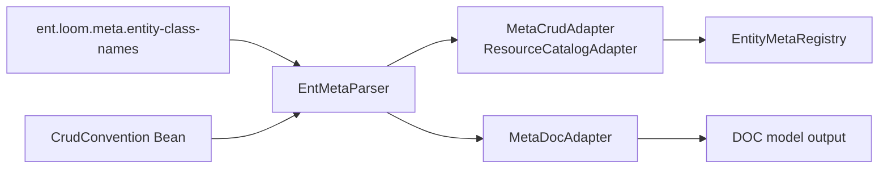

# Meta 运行时适配器当前实现

> 状态：Current
> 最近核验：2026-10-17（DDL 显式文本闭环）
> 范围：`ent-loom-meta`、`ent-loom-integrations`

本文记录 Meta -> CRUD / DOC / DDL 的静态运行时适配边界。

## 当前结论

Meta 体系当前已经形成静态运行时闭环：

- `ReflectiveEntMetaParser` 解析 `@EntEntity`、`@EntField`、`@EntRelation` 等母框架注解。
- `MetaCrudAdapter` 将 Meta Descriptor 和 CRUD 原生注解合并为 CRUD `EntityMeta` / `RelationEdge`。
- `MetaDocAdapter` 将 Meta Descriptor 和 DOC 原生注解合并为 DOC `DocEntityModel`。
- `EntLoomMetaAutoConfiguration` 在 Spring Boot 下按配置注册 CRUD / DOC adapter。
- CRUD Native Parser 收集 `CrudConvention`，由公共属性 Resolver 裁决后形成 CRUD 字段模型。
- 诊断策略支持 fail-fast / lenient，冲突在 registry 或 adapter 边界暴露。

## Spring 装配

`EntLoomMetaAutoConfiguration` 的装配条件：

- `ent.loom.meta.enabled=true` 或未显式关闭。
- `ent.loom.meta.base-packages` 或 `ent.loom.meta.entity-class-names` 非空时使用显式来源；缺省使用 Boot 自动配置包，没有任何来源时不注册适配器。
- `ent.loom.meta.crud.enabled=true` 或未显式关闭时注册 `MetaCrudAdapter`。
- `ent.loom.meta.doc.enabled=true` 或未显式关闭时注册 `MetaDocAdapter`。
- 自动配置在 CRUD auto-configuration 之前执行。

## Meta -> CRUD

`MetaCrudAdapter` 当前执行：

1. 对带 `@EntEntity` 的类解析 Meta Descriptor。
2. 同时解析 CRUD 原生注解和 `CrudConvention`，形成 native model。
3. 通过 `CrudRuntimeModelMerger` 合并两侧模型。
4. 输出 CRUD `EntityMeta`，包含 resource、table、id、logicDelete、字段元数据；当前 `createTime / createdAt + 时间类型` 默认投影为 `writable=false`。
5. 输出 `RelationEdge`，用于 CRUD 关系查询。外键声明通过 CRUD Core 的 `RelationNavigationFieldResolver` 按 `customerId → customer` 的名称与目标类型绑定单对象导航属性；无导航属性时保留外键关系字段，显式导航映射保持原样。唯一 CRUD Runtime Model 在构建阶段结合已注册实体的集合泛型及唯一反向多对一引用，补全本地一对多映射并保留推导规则来源；歧义不猜测，显式同名映射优先，模型合并后重新裁定。CRUD Native Parser 与 Meta Adapter 共用这条模型链；以上都不触发加载或授权，不回写 Meta Descriptor。
6. 将日期时间角色按既有 Contribution 优先级合并，保留到 CRUD 字段运行时模型、归属收窄与实体元数据；默认排序消费唯一 CREATED_TIME。对目标实体、sourceField、targetField 等关系错误收集诊断；其他日期角色虽保留元数据，但尚无自动填充行为，对应能力仍产生 `CONSUMER_UNSUPPORTED_PROPERTY` WARN。

`CrudRuntimeModelMerger` 对实体、字段和关系属性统一调用公共 `PropertyContributionResolver`，Adapter 只负责输入收集、模型投影和诊断传递，不按参数或 Bean 顺序裁决。

它实现 `ResourceCatalogAdapter`，因此能与业务自定义 adapter 一起进入 CRUD registry。测试覆盖自定义业务 adapter 与 Meta adapter 并存，以及重复资源编码在 registry 边界 fail-fast。

## Meta -> DOC

`MetaDocAdapter` 当前执行：

1. 解析 Meta Descriptor。
2. 解析 DOC 原生注解。
3. 通过 `DocRuntimeModelMerger` 合并文档模型。
4. 通过 `DocRuntimeModelOverrideApplier` 应用业务 `DocOverrideProvider`。
5. 输出 `DocEntityModel`，并通过 `EntityDocCoreService` 生成兼容 map。
6. 校验关系目标和字段，诊断配置错误。

`EntLoomMetaAutoConfiguration` 默认提供 `DefaultDocEntityMetaResolver`，并可接收业务提供的 `DocOverrideProvider`。

## Meta -> DDL

`MetaDdlAdapter` 合并 Meta 与原生 DDL 声明，支持 Meta-only、DDL-only 和混合覆盖。文本业务上限与 DDL 显式物理长度以 `DdlTextCapacity` 分别保存，携带属性声明路径；物理覆盖不再删除业务要求。未声明的业务上限保持 `-1`，默认 VARCHAR 长度不作为业务约束；数值参数继续沿用现有合并逻辑。

`sqlType` 已进入 `DdlFieldMetadata`，Bootstrap、Spring Loader 与 Starter 默认加载器同步承接。String + VARCHAR / CHAR / TEXT / MEDIUMTEXT / LONGTEXT 经统一容量解析后生效；支持组合不再产生消费未支持警告，其他非 AUTO 组合由 Core 明确拒绝，不回退 Java 默认映射。Core 不依赖 Meta Descriptor；无物理配置且有正业务文本上限的 String + AUTO 按有效字符集最坏字节数选择 VARCHAR / TEXT / MEDIUMTEXT / LONGTEXT，超限或缺失上下文拒绝计划；未声明业务约束的 AUTO 映射维持原合同。

DDL 引擎先从 MySQL JDBC 获取库/服务器默认值、表默认值和列覆盖值及 MAXLEN，再解析为 `MysqlTableResolution`，供 CREATE / Diff / ALTER 共同消费。新库、新表固定选定默认值，已有列 MODIFY/CHANGE 保留原字符集与排序规则；未知原始定义暴露有限校验范围，已知错误仍阻止计划，迁移安全白名单不扩大。三个入口、Starter 默认路径及 Meta-only/混合模型均已纳入 MySQL 8 验收，证据统一见 [DDL 实施清单](../../../evolution/roadmap/ddl/DDL实施清单.md#业务元数据到-ddl-推导补齐)。

## 已验证路径

测试 `EntLoomMetaAutoConfigurationTest` 覆盖：

- Meta 实体自动装配 CRUD registry 与 DOC adapter。
- CRUD-only 与 DOC-only 路径相互独立。
- 显式来源优先；缺省扫描 Boot 自动配置包，Meta 关闭或没有任何来源时不接管 CRUD fallback。
- 实体所属服务依次取实体声明、Meta 全局配置、Spring 应用名。
- 业务 `ResourceCatalogAdapter` 与 Meta adapter 并存。
- `DocOverrideProvider` 能覆盖实体名、分组和字段可见性。
- 重复 adapter 输出在 registry 边界 fail-fast。

测试 `MetaCrudAdapterP0AcceptanceTest`、`MetaDocAdapterP0AcceptanceTest`、`MetaCrudAdapterRelationDirectionTest` 覆盖静态 fixture、关系方向和 P0 验收。

`CrudConventionConsumerTest` 覆盖内置/项目 Convention 改变 CRUD `writable` 行为，以及消费者不支持属性的 WARN；`EntLoomMetaAutoConfigurationTest` 已扩展为 8 项，覆盖 Starter 收集项目 Convention Bean。

## 当前限制

- 当前闭环是启动期静态装配，不是运行期动态实体发现。
- 实体来源支持类名列表、显式包扫描与 Boot 自动配置包约定。
- CRUD Convention 当前只落地创建时间字段禁止更新这一项；其它自动填充和领域行为不由名称推断开启。
- DDL / UI / API 后续接入仍不属于当前闭环。
- CRUD Query/Command 的完整业务治理仍由 CRUD 自身主链负责，Meta adapter 只输出运行时元数据。

正文和富文本的 DDL 缺省策略：`CONTENT` 类型表达格式未限定的正文，`RICH_CONTENT` 表达富文本，两者无业务上限时由 Adapter 提供 TEXT 提示；普通 TEXT 仍保留 varchar(200)。明确业务上限时分别消费 `text.maxLength` / `richContent.maxLength`，交给统一容量选型。显式物理类型、长度、原始定义优先；上限仍独立校验。该投影不把 Meta Descriptor 引入 DDL Core，也不将多行展示或字段名称解释为正文存储要求。
