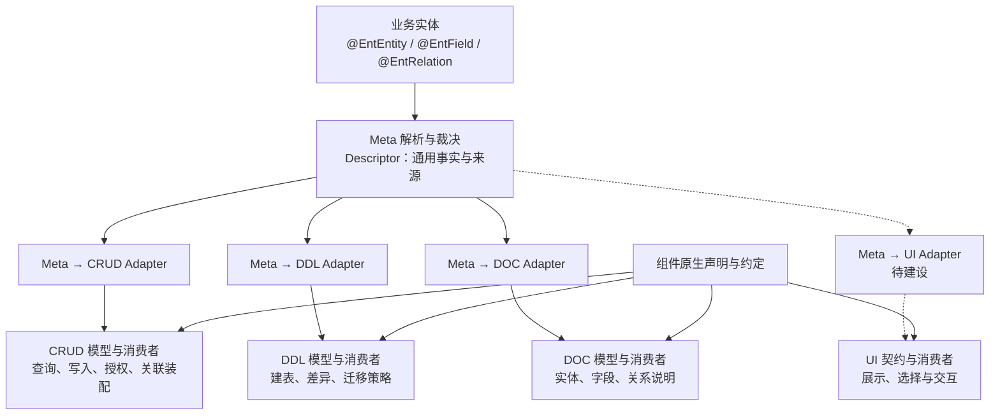
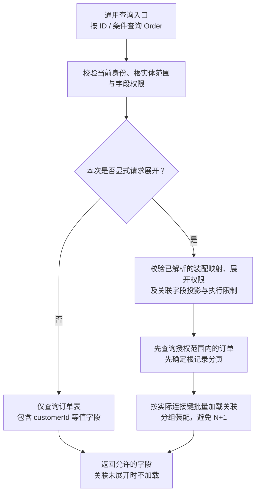

# 实体建模与查询核心思想

> 本文简要整理建模与查询共识；具体规则以[元数据约定与裁决契约](元数据约定与裁决契约.md)、[组件边界与依赖规则](组件边界与依赖规则.md)为准，不代表所有目标能力均已落地。

## Meta 提供事实，组件负责消费

`@EntEntity`、`@EntField`、`@EntRelation` 属于 Meta，统一表达实体、字段和关系的通用业务事实。各组件通过 Adapter 获得自己的运行时模型，再按各自规则执行。

- Meta 保留关系的源字段、目标实体、目标字段与基数；已注册实体的关系事实可形成索引，供组件投影使用。
- Adapter 负责投影和诊断；各组件拥有自己的模型，不建立跨模块万能 `EntityMeta`。
- 启动时解析、裁决并冻结模型；执行器只消费组件模型，不在每次查询时重新扫描 Meta 注解。
- 组件可以独立运行；组件原生输入与 Meta 输入最终汇入同一种组件模型和执行主链。

## 关系事实、装配映射与加载分别表达

**外键声明关系事实，结构属性承载数据，关联填充显式执行。**

| 层次 | 订单示例 | 含义 |
|---|---|---|
| 关系事实 | `Order.customerId → Customer.id` | `@EntRelation(Customer.class)` 声明实体引用 |
| 结构属性 | `Customer customer`、`List<OrderItem> orderItemList` | 承载业务结果，默认不映射订单表列 |
| 装配映射 | `Order.id → OrderItem.orderId` 绑定到 `orderItemList` | 集合泛型与唯一反向关系自动补全；歧义或特殊连接才显式配置 |
| 加载请求 | `expandRelations = ["customer", "orderItemList"]` | 本次查询按需展开，并校验映射、支持能力与权限 |

已有关系事实下，唯一映射自动补全，结构属性无需重复声明 `@EntCrudField`。没有关系事实时不推测外键；多个候选时不按扫描顺序选择，展开前必须用显式配置消除歧义。关系声明和映射不自动授予访问权限，也不自动开启加载、级联写入、级联删除或物理外键生成。

## CRUD 默认只查当前实体，展开按需选择

- 不传 `expandRelations`：只查询 `Order` 自身值字段；`@EntRelation` 不改变默认加载行为。
- 显式展开：只加载本次选择且获授权的关系；单对象无结果为 `null`，集合无结果为 `[]`。
- 声明式策略省略 `EXPAND` 时开放候选关联普通字段；仅字段差异需要配置，`NONE` 关闭、`INCLUDE` 固定投影、`EXCLUDE` 排除字段或关系。操作、身份及根记录范围仍须授权，普通查询仍不加载关联。
- Java `EntityDao.findById` 保持单实体、单表查询；通用 HTTP `detail` / `findOne` 通过 ID 条件查询，分别表达必须存在与允许不存在。
- 基础查询与支持的关联详情复用通用入口；特殊业务装配仍可由 Service / Handler 显式完成。

商城示例的 `customer`、`orderItemList` 只保留 `@EntField`，复用外键事实自动补全映射，再由查询请求和关联字段授权选择加载；默认仍只查询订单自身。规则和例外见[设计决策](../../evolution/decisions/core/关系映射自动补全与显式加载.md)，通用 HTTP 支持范围见[受授权关联读取](../../guides/crud/受授权关联读取.md)。
