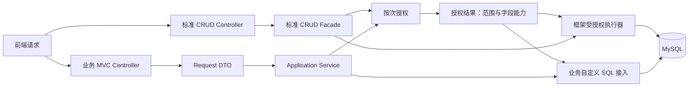
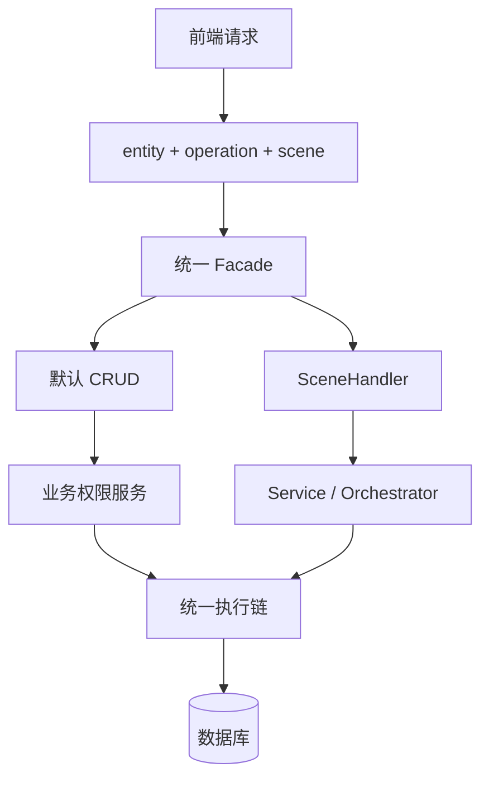
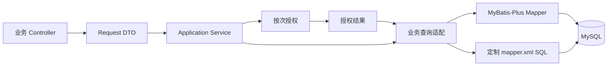
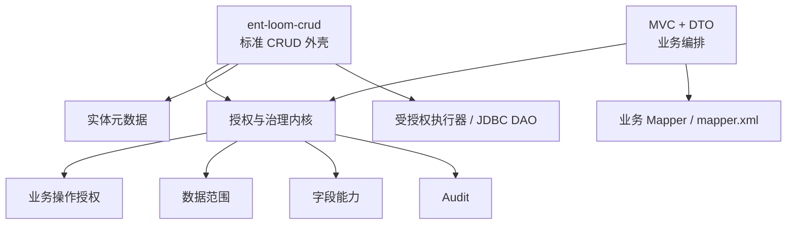
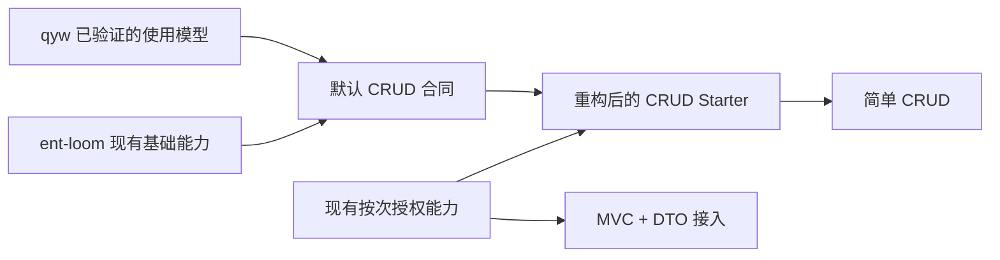

# CRUD 与 MVC 协同架构决策

> 状态：建议采用<br />
> 适用范围：ent-loom CRUD、标准 HTTP 接口、传统 MVC + DTO、MyBatis-Plus / mapper.xml<br />
> 本文描述目标和接入边界；已实现的能力以[业务实体访问治理当前落地流程](../../roadmap/crud/业务实体访问治理/当前落地流程.md)为准。2.0 重构见[详细设计](../../roadmap/crud/CRUD与MVC协同重构/详细设计.md)与[实施清单](../../roadmap/crud/CRUD与MVC协同重构/实施清单.md)。

## 1. 核心结论

业务项目按需组合使用两种模式：

- **标准 CRUD**：处理列表、分页、单表增删改、批量维护等稳定场景。
- **传统 MVC + DTO**：处理复杂查询、状态流转、跨实体编排、强业务权限和事务流程。

两者共享授权、数据范围、字段访问和审计能力，不强制共享 CRUD 请求模型、查询 DSL 或业务响应 DTO。HTTP 外层的错误码和分页约定可以统一。



## 2. 为什么当前 CRUD 使用起来吃力

当前 CRUD 把过多职责集中在一个模型中：

```text
实体元数据
+ HTTP 路由
 + YAML 权限
 + 数据范围
 + 字段治理
 + Scene
 + DAO
 + 复杂查询扩展
```

一个简单实体也需要理解实体声明、运行时注册、主体、scope、字段用途、route、scene、授权执行器和 DAO 链路。配置还存在多层默认值与合并规则，语法正确不代表语义正确。

当前的主要问题不是 CRUD 能力不足，而是：

- 默认行为不够明确；
- 简单 CRUD 也被完整权限模型包围；
- 配置承担了过多业务语义；
- MVC 定制与标准 CRUD 容易形成两套治理逻辑；
- 复杂 SQL 与通用 CRUD DSL 的边界不清晰。

## 3. qyw 为什么默认 CRUD 更顺

qyw 的优势来自一套完整的平台约定，而不是把所有业务规则配置化：

- 统一 Controller、Facade 和响应结构；
- 固定 `entity + operation + scene` 路由；
- 默认 CRUD 与定制 scene 共用同一入口；
- `accessEntry` 统一承载业务入口和权限上下文；
- 权限主要通过 Java 服务治理；
- 复杂业务进入 Handler、Service、Orchestrator；
- 前端只需要掌握稳定的默认接口。



qyw 的代价是定制复杂度较高。一个复杂动作可能需要 Controller、scene、Handler、DTO、Service、权限映射、错误码和事务编排。它解决了默认能力的易用性，但没有消除复杂业务本身的复杂度。

## 4. 权限边界

标准 CRUD 不能脱离权限，但权限不应全部配置化，也不应强行传播完整 CRUD 模型。

```text
标准 CRUD 必须经过权限执行
≠
所有权限规则都写入 CRUD YAML
```

职责划分：

| 能力 | 适合位置 |
|---|---|
| 身份解析 | 项目级适配器 |
| 资源与操作授权 | 统一业务授权入口 |
| 租户、组织、归属范围 | 授权结果中的数据范围 |
| 字段返回、写入、筛选、排序、统计、展开 | 授权结果中的字段能力 |
| 状态、流程、跨实体规则 | Application Service / 业务 Policy |
| 审计 | 统一治理内核 |
| 简单默认值与安全边界 | 实体元数据 / 少量配置 |


以现有 `BusinessAuthorizationService`、`AuthorizationRequest` 和 `AuthorizationResult` 为参考，评估符合目标的实现后复用或重做；不为 MVC 新建平行授权链。授权结果绑定本次访问者、资源、业务操作和可选目标；这些条件变化时重新授权。

- 可信准入提供访问者，不等于操作授权；缺少可信上下文、操作映射或必要能力时拒绝。
- 客户端提出的业务入口和学校等范围选择须经服务端校验，不能直接作为身份、归属或权限事实；入口或已校验的范围选择变化时重新授权。
- 框架执行器结合当前调用上下文和实际目标校验本次授权结果；原始 Mapper 的按次授权与实际约束由业务负责，不引入独立令牌或跨请求状态管理作为首期前置条件。
- 全量、无数据和受限范围明确区分；无数据表示没有可访问记录，不能解释为全量。
- 不同安全边界和业务筛选取交集，调用方只能收窄范围；字段能力还受实体静态上限约束。
- 字段按 `RETURN`、`WRITE`、`FILTER`、`SORT`、`STATS`、`EXPAND` 区分；脱敏及脱敏字段的筛选、排序权限须单独定义。
- 审计区分授权拒绝、执行失败和成功；写入成功只在事务提交后记录，审计故障不掩盖业务结果，不默认承诺审计与业务数据原子一致。

## 5. MVC + DTO 与 MyBatis-Plus / XML

MVC + DTO 不应重复实现权限，但也不应被 CRUD DTO、Query DSL、Scene 模型绑住。

推荐调用关系：



DAO 层可以继续保持 MyBatis-Plus 和 mapper.xml 的自然形态：

- 简单租户、逻辑删除等机械规则可由适用的拦截器处理；业务范围仍须明确落实；
- 业务数据范围由服务端根据本次授权结果生成，不能由前端传入、关闭或覆盖；
- 列表、count、JOIN、聚合和子查询须落实适用范围；关联资源按关系授权规则决定是否单独授权；
- 查询条件使用参数绑定，调用方的筛选、排序、统计和 DTO 输出须符合对应字段能力；
- 不让 XML SQL 自己读取当前用户；
- 不让拦截器尝试解析所有复杂 SQL。

**执行责任**：框架受治理的执行器和 DAO 必须实际消费授权结果；无法落实范围或字段能力的操作应在执行前拒绝。业务直接调用的原始 Mapper 不受框架自动保证：业务代码必须正确应用授权结果，并以集成测试验证数据、count 和拒绝行为；无法表达的范围不得省略条件或退化为全量。

业务可以将授权范围转换为查询专用的强类型 Scope，但传入 Scope 本身不代表 SQL 已应用它。对外宣称共享治理时，应明确哪些执行路径由框架保证，哪些由业务负责。

## 6. 目标分层



### 标准 CRUD 负责

- 稳定的 HTTP、Facade 和响应合同；
- 列表、分页、单表增删改、批量维护；
- 默认字段策略和安全边界；
- 统一调用授权与数据范围能力。

按实体明确开放操作和可写字段。状态、归属等受业务规则约束的数据只能通过满足相同不变量的入口修改；不能让通用更新或删除绕过业务流程。需要并发保护时，写入条件同时校验目标、授权范围和版本或状态；创建及归属变更须校验可信归属。

### MVC + DTO 负责

- 请求和响应 DTO；
- 业务编排和事务边界；
- 状态机、流程和跨实体规则；
- 复杂查询、报表和特殊写入；
- 消费按次授权结果，并落实范围、字段能力和审计。

### 不应强制共享

- 完整 CRUD DTO；
- CRUD Query DSL；
- CRUD Response；
- Scene 生命周期；
- 通用 SQL 改写器。

## 7. 重构建议

建议以 **qyw 的使用方式作为产品起点，以 ent-loom 的代码作为技术底座**，而不是直接复制 qyw 或继续扩张现有 YAML。



当前已有按次业务授权、受授权查询与 DAO，可按目标评估复用或清除重做，不先拆新模块或新增一套 SPI。新授权查询的 Scene 和多实体连接仍未开放；当前 JDBC 受授权 DAO 批量更新不接受外层活动事务。Stats、Import、Export 的统一业务范围和字段能力仍在收敛，详见[当前落地流程](../../roadmap/crud/业务实体访问治理/当前落地流程.md)和[实体 DAO](../../../architecture/components/crud/实体DAO.md)。

推荐按较小闭环推进：

1. 固定默认 CRUD 合同：路由、请求、响应、分页、字段和默认权限。
2. 选择一个真实实体，让标准 CRUD 与 MVC 自定义查询复用同一按次授权；业务查询只适配能正确落实的范围和字段用途。
3. 验证列表与 count 范围一致、字段用途限制、无数据时返回空结果，以及缺少授权或不支持范围时拒绝。
4. 按实体梳理业务不变量与 CRUD 可写边界；涉及写入时验证并发保护、事务和提交后审计。
5. 保留 SceneHandler 作为业务接管入口；新授权链只开放已完成治理适配的形状，不支持时拒绝。
6. 按实际接入完善启动期诊断和声明，YAML 保留必要的默认声明与安全边界。

冻结首期合同前，以 qyw 一个真实资源推演入口差异、学校与班级 / 学生集合范围及交集；推演不要求首期实现全部范围 SQL。首期示例还须展示普通实体从声明、授权到开放接口的最小完整接入，验证配置与业务代码的复杂度。

## 8. 最终定位

ent-loom 不应追求“所有业务都由实体配置自动生成”，而应定位为：

> **标准 CRUD 提效基础设施 + 传统 MVC 业务编排底座。**

最佳实践是：

```text
简单规则自动化
业务范围显式化
复杂 SQL 保持自由
权限决策集中化
标准 CRUD 与 MVC 共享治理原语
```
