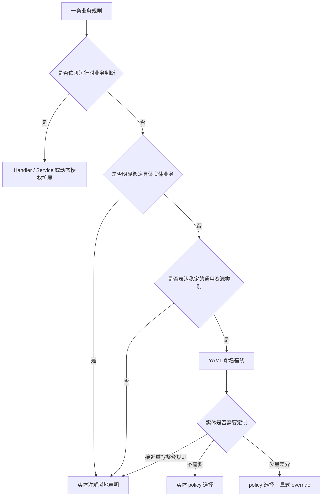
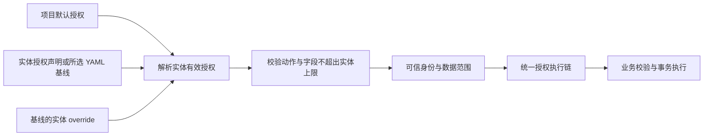

# 实体声明与授权基线风格

> 状态：Accepted · 2026-11-03
>
> 适用范围：ent-loom 框架与 mini-commerce 业务示例。本文记录声明位置与复用边界；配置语法以[配置参考](../../../guides/配置参考.md#yaml-授权基线与实体定制)为准。

## 目标

业务代码优雅、清晰，常规规则有默认值，必要差异可就地理解。评价设计时，同时考虑声明量、阅读跳转、修改位置和最终行为是否明确；不以减少注解数量作为唯一目标。

## 声明各归其位

| 内容 | 默认位置 | 风格约定 |
| --- | --- | --- |
| 实体与字段名称、类型、关系 | Meta 注解 | 一份事实驱动 CRUD、DDL、文档；中文名称显式表达，不靠字段名猜测业务含义 |
| 动作及字段上限、输入约束、HTTP 暴露 | `@EntCrudEntity` 与字段约束 | 使用默认约定，只写必要例外 |
| 明显属于具体实体的身份授权 | `@EntCrudGrant` | 就地声明身份、动作、范围和字段白名单 |
| 通用资源类别的稳定授权 | YAML 命名基线 | 实体通过 `@EntCrudEntity(policy = "...")` 显式选择 |
| 基线的少量实体差异 | `policy-overrides` | 明确定位资源与身份；不复制完整策略 |
| 项目归属约定、管理员默认授权 | YAML `grant-defaults` | 项目配置一次，实体显式覆盖例外 |
| 订单状态、余额、跨实体编排 | Handler / Service | Java 表达动态规则，事务内落实业务约束 |

## 基线如何选择

**按业务语义判断复用，不机械统计使用方数量。** 通用资源类别可以暂时只有一个使用方；几个实体恰好拥有相同 CRUD 动作，也不足以证明它们应共享策略。不为尚不明确的场景预造基线。

| 当前选择 | 依据 |
| --- | --- |
| 保留 `customer-owned` | “客户维护所属资源”，可适用于银行卡、地址等；当前由银行卡使用 |
| 保留 `merchant-managed-customer-readable` | “商家维护、客户只读本人资源”，当前由会员等级使用 |
| 商家与客户主数据就地声明 | 本人主键范围、所属商家范围、公开摘要属于主数据特例 |
| 商品就地声明 | 上架条件、商品摘要、批量改价属于商品业务 |
| 订单就地声明 | 下单、取消及管理员限制属于订单流程 |

接口表达 Java 类型能力或结构契约，不通过接口注解继承决定权限。不为减少几行声明引入组合注解、继承层级或多策略自动合并。

## 默认、定制与授权边界

- 基线定制：省略属性继承；显式列表完整替换；`actions: []` 撤销该身份权限。未知身份定制拒绝，避免隐式新增分支。
- 当前同一实体选择 YAML 基线后，不再混用 `@EntCrudGrant`；需要差异时使用 `policy-overrides`。
- `public` 与 `customer` 显式授权，不互相继承。公开数据使用字段白名单，避免新增字段自动公开。
- 项目显式配置 `super-admin` 默认拥有声明式实体的全部已声明动作与全量范围；仍受实体字段上限、业务校验约束。框架不硬编码身份放行。
- 实体显式声明同一管理员身份时，整体覆盖项目默认。例如订单只开放 `view/cancel`，不补回下单权限。
- 当前 `@EntCrudGrant(actions = {"*"})` 不支持；全局全部动作能力由 `CrudGrantDefaults` 提供。不能将设计意图写成已支持语法。
- `httpExposed = false` 只关闭通用 HTTP，不产生 Java 调用权限。内部实体是否授予普通身份权限，必须单独作出业务决定。

## 业务动作的默认分层

- 默认采用 `Handler → 业务 Service → 数据访问`：Handler 注册动作并适配输入输出，Service 承担事务与业务编排。
- 同一业务不同时维护应用 Service 与空的持久化 Service；仅在存在明确复用或独立变化时拆分操作组件，不要求每项职责对应独立类型。
- 根实体优先通过 `AuthorizedActionContext.dao(...)` 访问，复用框架范围校验与 SQL 条件，不在业务中重新解释授权范围树。
- 业务状态条件通过 DAO 的附加 `RowConstraint` 与授权范围取交集；局部修改使用 Patch，避免全量更新覆盖并发变化。
- 跨实体访问按实际业务关系与框架关联 DAO 合同处理；使用原始 Mapper 的路径仍须显式落实业务边界，不能因根实体已授权而自动放行。

## 实现与演进约束

- 注解、YAML、Java 策略复用统一授权编译与执行链；配置来源不同，不产生另一套授权执行语义。
- 绑定来源显式区分，不根据策略名称前缀猜测来源。未知策略、重复绑定及越界配置启动失败。
- 配置重构保持身份、动作、范围、字段和管理员例外不变；不能为让测试通过而顺带改变权限预期。
- 小闭环包含所需框架实现、业务调用方、示例、文档和针对性验证；非必要的抽象与能力扩展留到具体需求出现时。
- 当前未上线，无需保留旧入口或兼容层；清理旧声明时按语义判断，不能仅因使用次数少就删除通用基线。

业务示例与细节见[商城授权整合最佳实践](../../../../examples/mini-commerce-spring-boot/docs/授权整合最佳实践.md)。
