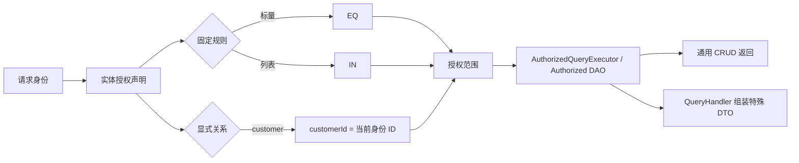

# 访问范围与查询扩展的较小闭环

## 决策

实体访问配置只覆盖稳定、可预测的授权边界：

- `rules` 表达简单字段规则；标量值默认 `EQ`，列表默认 `IN`，多个字段默认 `AND`。
- `scope` 继续表达 `all` 或显式身份关系，例如 `merchant`、`customer`。
- 身份关系必须通过配置声明，不能仅凭 `customerId` 等字段名猜测归属。
- 树形、分组、聚合、跨实体组合等复杂查询由自定义 QueryHandler 实现。
- Handler 必须消费授权查询入口，规则和身份归属范围由框架统一叠加。

```yaml
crud:
  access:
    public:
      actions: [view]
      rules:
        active: true
        status: [PUBLISHED, RECOMMENDED]
```

规则的执行结果与身份关系范围相交：



## 示例

公共商品只返回已启用数据：

```yaml
crud:
  access:
    public:
      rules:
        active: true
```

商家只查询自己的已启用商品：

```yaml
crud:
  access:
    merchant:
      scope: merchant
      rules:
        active: true
```

## 边界

YAML 暂不提供 `OR`、嵌套条件、脚本或 SQL。出现复杂访问范围时，增加受控 Java 授权扩展；出现复杂返回结构时，增加 QueryHandler。不要为少量场景继续扩张 YAML DSL。

`AuthorizationScope` 保留为 Core 内部统一范围模型；删除 `NamedAccessScope` 公共注册能力，避免同时维护配置 DSL 和具名 Java 范围目录。
