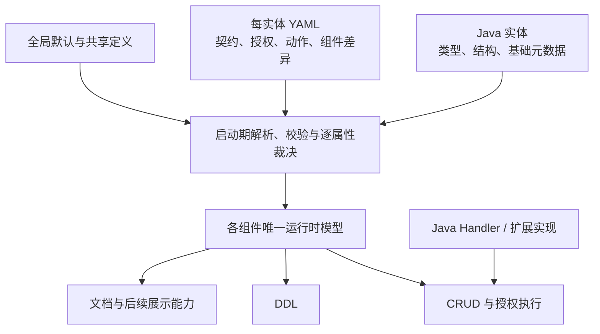

# 实体声明集中化方向

> 状态：Implemented（完整迁移）
> 日期：2026-10-16
> 目标：以实体为单位集中声明业务配置，减少 Java 注解与全局 YAML 之间的分散查找。

## 1. 问题与方向

当前同一实体的声明分散在实体注解、`access.entity-options`、`contracts` 等入口。新增能力时继续逐项增加注解或全局配置节点，会增加理解和维护成本。

拟采用“Java 实体 + 每实体一份 YAML”：Java 描述类型和结构，实体 YAML 集中描述组件契约与业务配置。简洁依靠默认约定、只写差异和单一声明来源。

## 2. 职责划分

| 位置 | 职责 |
|---|---|
| Java 实体 | 字段、类型、泛型、枚举、关系结构；保留 `@EntEntity`、`@EntField` 等基础中文说明及适用的校验约束 |
| 实体 YAML | 策略绑定、字段授权、操作开放与映射、自定义动作、输入契约、关系角色与归属差异、索引等组件声明 |
| 全局 YAML | 运行参数、全局默认值、共享策略与关系定义；实体文件只引用或声明差异 |
| Java 实现 | Handler、授权解析器、字段补齐、复杂业务规则和实际执行行为 |

关系结构继续以 Java 元数据为准；YAML 中的关系角色映射引用已有字段，不重复定义字段类型和关联结构。Lombok、Bean Validation 等 Java 工具注解不在搬迁范围内。

## 3. 编译与执行边界



- 接入既有编译与裁决链，不建立第二套注册表或执行语义；模块独立运行边界保持不变。
- 公共层只负责文件发现、资源码关联和来源定位，CRUD、DDL、DOC 分别解析、校验自己的节点并生成运行时模型；公共加载器不依赖各组件实现。显式配置了未安装或未启用的组件时拒绝启动。
- 迁移属性由实体 YAML 作为唯一显式声明入口，彻底删除对应注解及被替代的全局配置路径，不保留兼容入口或双源覆盖规则。
- 纳入通用 HTTP 的实体必须有实体声明文件及明确的访问声明；文件缺失、漏扫描或漏打包均拒绝启动，不得降级为未绑定策略的执行路径。
- 不重复维护 Java 类型和字段清单；未知字段、策略、动作、重复实体与未知配置项在启动期拒绝，并定位到文件、实体及配置路径。
- 首期采用随应用发布的静态文件；动态模型、热更新和可视化编辑后续按实际需求评估。

删除范围包含旧注解定义、解析链、自动装配及相关示例、测试和文档；测试同步迁移到 YAML 入口，继续验证原有业务合同。基础元数据、关系结构及 Java 工具注解保留，Handler、授权解析器和运行时模型构建等程序化扩展能力保留。

## 4. 表达示意

采用以下实体文件契约。采用 `resources/ent/entities/<资源码>.yml` 组织，文件名关联已注册实体；扫描全部类路径及依赖 JAR，重复资源码拒绝，首期随应用发布，不引入独立版本号。

```yaml
# ent/entities/merchantProduct.yml
crud:
  operations:
    update: [UPDATE, UPDATE_BATCH]
```

```yaml
# ent/entities/customer.yml
crud:
  contracts:
    create:
      input-required-fields: [displayName, email]
```

操作映射按业务动作覆盖，规则固定如下：

| 声明 | 含义 |
|---|---|
| 省略 `operations` 或声明 `{}` | 沿用已选策略允许动作的标准缺省映射 |
| 省略某个动作 | 该动作沿用标准缺省映射；自定义动作须显式声明 |
| 动作声明非空列表 | 整体替换该动作的技术操作列表，不追加合并，不影响其他动作 |
| 动作声明 `[]` | 仅登记业务动作，不提供通用 CRUD 映射；不等于删除授权 DAO 使用的业务动作 |
| `operations` 或动作值为 `null` | 配置错误，拒绝启动 |

此规则明确替代当前“显式目录整体覆盖”的行为，不保留旧覆盖模式。批量操作继续要求显式开放，`UPDATE_BATCH` 中每项目标独立执行 `update` 授权，声明映射不等于授予权限。

输入契约要求请求显式提供字段，与实体最终值非空、数据库约束分别建模；迁移位置不改变既有输入校验语义。字段授权的 INCLUDE / EXCLUDE 等模式也须完整保留。

## 5. 最小落地顺序


- `Order`：验证策略绑定、关联字段授权、自定义动作与索引。
- `Customer`：验证创建输入契约、字段引用与错误定位。
- `MerchantProduct`：验证标准操作缺省、批量显式开放及逐目标授权。

先比较完整声明的可读性和维护成本，再确定最终语法及迁移范围。验收同时覆盖配置失败诊断与实际运行行为，迁移前后权限、输入校验和事务合同保持一致。

首期提供 YAML Schema 与 IDE 补全，并在持续集成中复用启动期的语义校验；覆盖文件缺失、重复资源、字段与策略引用、组件缺失及操作映射规则。按新覆盖规则迁移声明，以运行行为等价为验收依据，不保留兼容解析层。

## 6. 与现行契约的关系

本文件记录总体方向与首期实施边界。实施时须明确 YAML 属性在裁决体系中的来源与优先级，并同步更新：

- [元数据约定与裁决契约](../../../architecture/core/元数据约定与裁决契约.md)
- [外部输入契约与实体校验边界](../../decisions/crud/外部输入契约与实体校验边界.md)
- [策略声明与缺省约定](../crud/业务实体访问治理/策略声明与缺省约定.md)
- [配置参考](../../../guides/配置参考.md)


## 7. 实施记录（2026-10-16）

公共目录实现静态发现、重复资源与键检查、冻结及来源定位。CRUD、DDL、DOC 独立解释节点，复用既有策略、输入契约、索引和文档模型。策略、字段权限、操作开放、自定义动作、索引及 DOC 示例/关系展示属性的旧注解与解析入口删除，全局实体差异和输入契约同步删除，示例与测试使用实体文件。

Customer 通过 `crud.policy` 选择具名策略，创建、更新和读取共用授权链。Order 的动作和索引集中到文件，MerchantProduct 显式开放批量操作。Schema、IDE 关联和 Maven 语义回归覆盖缺失文件、未知组件、资源/字段引用和非法节点。

基础中文描述、Java 类型、关系结构、校验与 Handler 注解保留。暂不引入热更新、可视化编辑或第二套执行模型。

### 声明边界修正

- CRUD 在治理服务装配时统一包装权限服务，应用自定义权限服务仍受实体操作与动作白名单约束。
- DDL 的普通 `load` 仅编译请求实体；启动期通过 `MetadataLoader.validateDeclarations` 使用完整发现范围校验声明，兼顾子集生成与漏扫描拒绝。独立调用方需要全量声明检查时显式调用该方法；自定义加载器可覆盖该方法完成自身声明检查。
