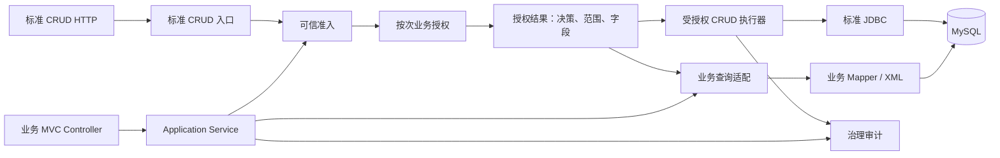
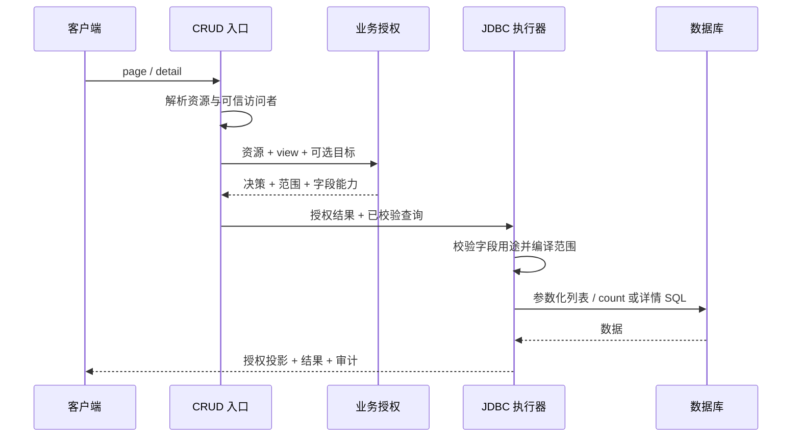
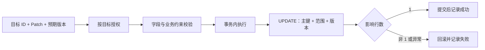

# CRUD 与 MVC 协同重构详细设计

> 状态：Target，尚未实施<br />
> 基线：`codex/crud-mvc-refactor`、`2.0.0-SNAPSHOT`<br />
> 决策依据：[CRUD 与 MVC 协同架构决策](../../../decisions/crud/CRUD与MVC协同架构决策.md)<br />
> 任务与验收：[实施清单](实施清单.md)

## 1. 目标与范围

提供一条面向实体的标准 CRUD 路径，并让传统 MVC + DTO 使用同一套按次业务授权能力。两种入口的每次请求分别授权、消费各自结果。普通实体操作尽量使用框架默认能力；复杂查询、状态流转和跨实体事务由业务代码表达。

本设计是 2.0 目标，不表示当前代码已经满足。当前实现与历史验收只供盘点和参考；新旧接口不要求兼容。已发布的 `1.0.1` 和 Git 标签保留，2.0 使用新版本发布。

### 首个可验收闭环

以商家商品 `merchantProduct` 为参考实体，完成：

1. 标准 HTTP 的分页、主键详情和单目标局部更新。
2. 同一资源的 MVC + DTO 自定义分页查询，使用同一业务操作授权。
3. 商家范围、字段用途、版本并发保护、错误与审计的真实执行验证。

首先闭合读取与更新；标准创建、删除随后按第 7 节完成。批量、统计、导入导出、关联展开和 Scene 属于后续能力，未完成前不对外开放，也不能回退旧执行链。

## 2. 总体结构



| 职责 | 框架 | 业务项目 |
| --- | --- | --- |
| 身份 | 定义可信访问者合同和准入边界 | 认证凭证、身份及归属来源 |
| 授权 | 操作、范围和字段能力的统一结果 | 提供业务权限和关系事实 |
| 标准 CRUD | HTTP 合同、字段校验、范围 SQL、事务和审计 | 声明开放操作、字段及业务约束 |
| MVC | 提供可直接调用的授权能力 | DTO、业务编排、事务及自定义 SQL 的实际约束 |
| 数据建模 | 复用实体元数据和必要的运行时投影 | 声明实体、关系及业务语义 |

MVC 不要求使用 CRUD 请求 DTO、查询 DSL、响应 DTO 或 Scene。统一错误码、请求追踪和分页外层约定可以复用，但业务响应内容由业务定义。

## 3. 重构与模块边界

- 旧 CRUD 执行链、授权治理、配置和相关示例均可清除重做；不保留旧入口、兼容开关或无授权回退。
- 现有 `BusinessAuthorizationService`、授权范围、字段能力及测试是语义和实现参考；符合目标且能简化实现的代码可以整理后复用，不要求保留原类名或旧内部结构。
- 首期保持授权合同与 CRUD Spec、HTTP、Spring 和 JDBC 解耦。可先放在现有 CRUD Core 的独立职责包，供 MVC 调用；仅因实际依赖边界需要才拆独立 artifact，不预设新模块。
- CRUD Core 不依赖 Spring、Servlet、JDBC 实现或 `meta-core`；Spring 集成与事务留在 Starter，SQL 实现在存储适配层。
- 完整 Reactor 使用 JDK 21；框架无关 Core 以 Java 8 为兼容目标，Boot 3 / 4 集成线以 Java 17 为目标，是否已支持以兼容性决策和实际验证为准。
- Meta、DDL、DOC、UI 与 `ent-runtime` 不随 CRUD 一并清空；检查并迁移真实依赖，避免保留旧 CRUD 类型或反向依赖。
- 重点盘点 `ent-loom-meta-adapter-crud`、`ent-loom-meta-adapter-doc`、可选 `ent-loom-runtime-adapter`、E5 测试、两个示例及 CI。无需保留的能力从 Reactor 和调用方同步清理。

每次切换一个可验收能力组：完成后该能力只保留一条正式执行路径，相关调用方、测试和当前文档一起迁移；尚未完成的能力明确关闭。Git 历史用于回看旧实现，不在新分支保留平行运行的旧链。

## 4. 可信上下文与授权

### 4.1 按次授权合同

| 对象 | 必要语义 |
| --- | --- |
| 可信访问者 | 已认证主体或明确的匿名访问者、业务身份、服务端入口、请求与链路标识 |
| 业务操作 | 稳定的资源码和操作码；标准 HTTP、Scene 和 MVC 均由服务端映射 |
| 授权请求 | 可信访问者、业务操作及可选目标 ID；请求载荷不是授权事实 |
| 授权结果 | 允许或拒绝；允许时携带明确范围、字段能力和原请求关联，拒绝时区分操作级拒绝与目标不可访问 |

访问者、经过校验的入口或范围选择、资源、操作或目标变化时重新授权。认证与授权分开：缺失或无效凭证不能伪装成已认证身份；只有资源显式开放匿名访问时才允许匿名准入。未知资源、未开放操作、缺失策略或无法判定时默认拒绝。

路径中的业务入口、请求中的学校等范围选择均是不可信输入。服务端须校验入口是否适用于资源及当前访问者，校验所选范围是否在访问者可访问范围内，才能将校验后的值纳入授权上下文；筛选值和选择值本身不证明身份、归属或权限。无法校验时拒绝，不把缺失或非法选择解释为全量。

授权结果仅供服务端本次执行消费，不能由客户端提交、篡改或跨请求复用。框架入口为本次调用建立执行上下文，执行器结合当前执行上下文和实际操作目标校验授权结果，不能仅因调用方同时传入原授权请求和结果就认为适用。标准 HTTP 和框架受授权执行器负责落实该约束；原始 Mapper 路径由业务保证每次调用重新授权并消费本次结果。首期使用进程内调用上下文即可，不引入独立令牌或跨请求状态管理。

### 4.2 范围与字段

范围显式区分 `ALL`、`NONE` 和受限条件；`NONE` 表示允许该操作但没有可访问记录，不等同于授权拒绝。调用方业务筛选与授权范围取交集，只能收窄。不同安全边界取交集；涉及多个关联资源时，按其关系授权规则判断每个资源是否需要单独授权。

字段能力至少区分 `RETURN`、`WRITE`、`FILTER`、`SORT`、`STATS`、`EXPAND`。最终能力受实体静态上限和本次业务授权共同限制，未授权用途不能通过查询、排序、计数或聚合侧面暴露。脱敏和脱敏字段的其他用途单独定义；首期未适配时拒绝，不假设隐藏输出即可授权筛选。

### 4.3 配置与缺省

- 全局 HTTP Controller 默认关闭；实体和操作须显式开放并绑定有效业务授权。实体注册或字段存在不等于授权。
- 身份、资源和操作使用稳定 code；身份从可信适配器获取，不能从请求体、普通 Header 或过滤条件推导。
- 元数据定义持久化字段、主键、生成方式、不可写及隐藏等静态边界。首期资源通过明确选用的策略模板或实体声明确定可返回、可筛选、可排序和可写字段上限；动态授权不能扩大上限，未授予的用途默认拒绝。
- 系统字段、归属字段、版本字段及未授权字段不能作为普通业务写入；未知字段或未授权用途明确拒绝，不静默丢弃。
- 声明来源统一编译、校验并冻结；重复或冲突声明、未知资源、操作、字段和关系启动失败。实体差异使用实体或 Handler 注解，复杂规则使用 Java 业务策略，应用 YAML 用于运行与部署配置。
- 默认策略只用于已明确绑定的实体；禁止在缺策略或编译失败时推导出全量授权。

首期参考实体的声明语义如下：

| 项目 | `merchantProduct` 首期约定 |
| --- | --- |
| 资源及身份 | 资源码 `merchantProduct`；商家身份及其 ID 来自可信准入 |
| 操作映射 | page / detail 映射 `view`；update 映射 `update`，单目标操作绑定目标 ID |
| 商家范围 | `merchantId` 等于当前商家 ID；管理员只有明确授权时才可使用 `ALL` |
| 字段上限 | `RETURN`：`id/name/price/active/version`；`FILTER`：`active`；`SORT`：`id`；`WRITE`：`price` |
| 写入边界 | `merchantId` 不能由客户端修改；`version` 只作为并发条件并由服务端递增 |

模板和元数据可复用相同声明，实体只表达差异；新增字段是否纳入上限由声明方式决定，不能仅因存在于实体就获得动态授权。

## 5. 标准 CRUD 合同

下列路径为 2.0 目标合同，最终由合同测试冻结；`{resource}` 由服务端注册表解析，不接受请求体切换资源。

| 阶段 | 操作 | 路径，相对 `/api/ent-crud` | 核心语义 |
| --- | --- | --- | --- |
| 首期 | 分页 | `POST /{resource}/page` | 范围内单表分页和精确总数 |
| 首期 | 详情 | `POST /{resource}/detail` | 唯一主键，范围外与不存在同为未找到 |
| 首期 | 更新 | `POST /{resource}/update` | 单目标局部更新，按目标授权 |
| 后续 | 创建、删除 | `POST /{resource}/create`、`/delete` | 单表创建及按主键删除 |
| 后续 | 列表、批量、Scene 等 | 按实际需求确定 | 单独定义规模、授权与事务合同 |

分页从 1 开始，默认每页 20 条，上限 100 条；非法参数拒绝。首期支持已声明的字段 `EQ` 筛选和 `ASC` / `DESC` 排序，并使用主键作为稳定末级排序；不接受 SQL 片段或任意表达式。调用方指定排序和框架追加的主键排序均须具备 `SORT` 能力；静态上限未开放主键排序时不能开放分页，本次授权未授予时拒绝分页。查询和 count 使用同一授权范围、逻辑删除及业务筛选；是否跨两条 SQL 保持同一数据库快照由事务隔离级别决定。

请求示意：

```json
{
  "options": {
    "page": 1,
    "limit": 20,
    "filterMap": {"active": {"op": "EQ", "value": true}},
    "sorts": [{"field": "id", "direction": "ASC"}]
  }
}
```

成功响应至少包括 `success`、`code`、`data` 和请求追踪标识；分页 `data` 包含 `items` 与 `page`，后者包含页码、每页数量和总数。首期仅返回授权字段；`NONE` 返回空列表和总数 0，详情返回未找到。

```json
{
  "success": true,
  "code": "OK",
  "data": {
    "items": [{"id": 101, "name": "商品甲", "price": 10.00, "active": true, "version": 0}],
    "page": {"page": 1, "limit": 20, "total": 1}
  },
  "requestId": "request-1"
}
```

详情使用独立的目标 ID，例如 `{"id": 101}`；缺少主键、携带多个目标或其他筛选条件时拒绝。目标 ID 用于定位和按目标授权，不作为普通 `FILTER` 字段；普通分页筛选主键仍须具备 `FILTER` 能力。单目标操作提取目标后按该目标授权，并将同一目标用于实际执行。

更新示意，`id` 是目标，`version` 是预期版本，不是普通更新字段：

```json
{
  "payload": {"id": 101, "version": 0, "price": 11.50}
}
```

局部更新区分未提供、显式 `null` 和具体值；未提供不修改，显式值须通过字段能力、实体静态约束与应用校验。不得按 Java 类型推断外部请求必填；创建输入要求与最终实体约束分开。

| 场景 | 目标响应 |
| --- | --- |
| 格式、字段、分页或不支持的请求形状错误 | `400`，稳定校验错误码 |
| 缺少可信上下文、操作级授权或必要字段能力 | `403`，权限错误码 |
| 资源未开放，或详情目标不存在 / 不可访问 | `404` |
| 更新或删除目标不存在 / 不可访问，或版本冲突 | `409 WRITE_CONFLICT` |
| 未预期的执行异常 | `500`，不返回 SQL、密钥或内部堆栈 |

操作级拒绝与具体目标无关，返回 `403`；操作级允许后，目标授权阶段判定目标不存在或不可访问，与执行阶段范围未命中使用相同的目标响应：详情为 `404`，更新和删除为 `409 WRITE_CONFLICT`。同一次授权调用可以依次完成操作和目标判定，但须保留上述拒绝分类，供入口映射响应。授权无法判定时仍须拒绝，内部记录原因，不向客户端区分目标是否存在；不为区分冲突原因额外探测目标存在性。

HTTP 包装不替代业务 DTO。请求 ID 和 trace ID 来自可信服务端上下文或经过校验的追踪机制，不参与授权判断。

## 6. 查询与 MVC 自定义 SQL

### 6.1 标准查询



框架执行器必须实际消费本次授权结果。字段名先映射为已注册元数据中的列名，值使用参数绑定；未知字段、无法编译的范围或不支持的条件在 SQL 前拒绝。输出按 `RETURN` 白名单构造，内部范围字段不会自动进入响应。

### 6.2 MVC 查询示例

首个 MVC 查询返回商品摘要，与标准分页使用同一个 `merchantProduct/view` 业务操作和授权服务，但每次请求分别授权，并使用自己的请求和响应 DTO。服务端完成以下步骤：

1. 从可信准入取得访问者，按 `merchantProduct/view` 授权；拒绝时不调用 Mapper。
2. 校验摘要输出 `id/name/price`、调用方筛选 `active` 和排序 `id` 分别具备相应用途。
3. 将授权范围转换为业务查询支持的强类型条件。首期支持明确的 `ALL`、`NONE` 及 `merchantId = 可信商家 ID`；`NONE` 直接返回空分页，其他无法表达的范围在查询前拒绝。
4. 对商家受限分支，列表与 count 均绑定相同的商家 ID 和筛选条件；`ALL` 使用明确的全量分支，不能用空参数暗示全量。
5. 使用固定 DTO 投影组装响应，记录拒绝、执行失败或成功审计。

商家受限分支的 SQL 形状示意，具体 Mapper 与 SQL 由业务实现：

```sql
SELECT id, name, price
FROM merchant_product
WHERE merchant_id = ? AND active = ?
ORDER BY id ASC
LIMIT ? OFFSET ?;

SELECT COUNT(*)
FROM merchant_product
WHERE merchant_id = ? AND active = ?;
```

绑定的商家 ID 来自授权范围，而不是客户端。业务 DTO 可以选择筛选条件，但不能改变或关闭授权范围；动态排序只能使用服务端白名单。MyBatis-Plus、XML 或其他 Mapper 自身不会因接收 Scope 而自动受框架保护。

**责任边界**：框架支持的受授权执行器负责落实并验证范围和字段；直接使用原始 Mapper 时，由业务代码落实授权、范围、字段、参数绑定与审计，并以集成测试证明。框架不声称能够拦截所有原始 Mapper；业务不得将无法落实的范围降级为全量。没有 MyBatis-Plus 依赖的示例不因本设计自动增加依赖，具体接入按示例工程约定处理。

## 7. 写入、业务规则与事务

### 7.1 单目标更新



若实体有版本字段，请求必须带预期版本；实际 SQL 同时包含主键、授权范围、逻辑未删除和版本条件，成功自增版本。无版本实体不传版本。影响行数必须为 1；未命中统一冲突，不能先检查权限再执行无范围更新。

状态、归属和跨字段不变量须由所有写入口共同保证。通用 CRUD 只能开放不破坏这些规则的字段；状态变更、跨实体流程或特殊副作用走业务 Service。并发条件须进入同一写入谓词或通过事务锁落实，不能只依赖写前读取。

### 7.2 创建和删除

- 创建不从客户端信任租户、商家等归属。服务端根据可信身份与本次授权补齐并验证最终归属；范围无法安全落实时拒绝。数据库默认值、触发器等不得绕过范围校验。
- 删除按目标重新授权，SQL 同时约束主键、范围、逻辑删除状态和适用版本；根据实体明确选择逻辑删除或物理删除。存在业务状态或跨实体不变量时不开放默认删除。
- 批量写入后续单独定义逐目标授权、目标数量上限、版本和事务结果；默认全量成功或回滚，不以逐条调用冒充原子批量。

## 8. 扩展、审计与异步

- 复杂业务优先使用 MVC + DTO 和 Service；确有统一入口需求时再恢复 SceneHandler。Scene 的业务操作须显式映射并授权，Handler 不能仅凭入口准入获得其他资源权限。
- 审计至少关联可取得的可信主体、资源、操作、可选目标、请求 / trace 标识、决策、结果和时间；匿名或准入失败时主体可以缺省，不记录敏感载荷或完整敏感字段值。
- 区分授权拒绝、执行失败和成功。写入成功只在实际事务提交后记录；参与外层事务时监听最终提交 / 回滚。审计故障不覆盖原业务异常，也不把已提交写入变成可重试失败；首期不承诺审计与业务数据原子持久化。
- 异步任务不隐式继承线程身份；后续支持任务时，执行与文件下载须重新建立可信上下文并按当时策略授权。
- Stats、Import、Export、文件任务、批量及关联展开分别落实操作、范围和字段合同后才开放；不支持的路径关闭或在副作用前拒绝。

## 9. 验收与完成标准

| 验收 | 必须覆盖 |
| --- | --- |
| 接入 | 无凭证、无效身份、未注册资源 / 操作、缺策略及伪造身份均不能执行；匿名只按显式策略开放 |
| 上下文 | 校验入口与资源、访问者的关系及范围选择；切换入口或学校时重新授权，非法选择不能扩大范围 |
| 范围 | 两商家互不可见；业务筛选只收窄；`ALL`、`NONE`、不支持范围分别验证 |
| 字段 | 返回、写入、筛选、排序分别校验，包含分页隐式主键排序；未授权的敏感字段不能通过 DTO、count 或排序泄露 |
| 查询 | 标准 CRUD 与 MVC 分别执行同一业务操作的按次授权；主键目标不依赖 `FILTER`；列表和 count 条件一致，范围外详情返回 404 |
| 授权绑定 | 框架执行器拒绝跨请求、访问者、入口、资源、操作或目标复用的结果；原始 Mapper 的业务接入以集成测试验证按次授权 |
| 写入 | 归属字段受保护；越权目标、旧版本和不存在目标不产生写入；目标授权和 SQL 未命中按合同返回，不泄露目标存在性 |
| 审计 | 拒绝、执行失败、提交成功及外层事务回滚时点正确；审计失败不改变业务结果 |
| 迁移 | 同一能力无旧入口和无授权回退；同步迁移或删除旧配置、调用方、测试、示例与文档 |
| 易用性 | 示例展示普通实体从声明、授权到开放接口的最小完整接入；检查配置和业务类数量，避免恢复多层重复声明 |

冻结授权合同前，以 qyw 的一个真实资源做合同推演：覆盖学校与班级 / 学生集合的多维范围交集、业务入口差异及无法表达时拒绝。记录映射和缺口；该推演不要求首期开放 qyw 接入、集合范围 SQL 或复杂查询。

目标完成时，使用 JDK 21 验证完整 Maven Reactor、相关示例和文档站；持久化关键路径以 H2 和 MySQL 8 验证。公开版本发布后，使用干净 Maven 仓库重新验收 Central 构件。具体任务见[实施清单](实施清单.md)。
