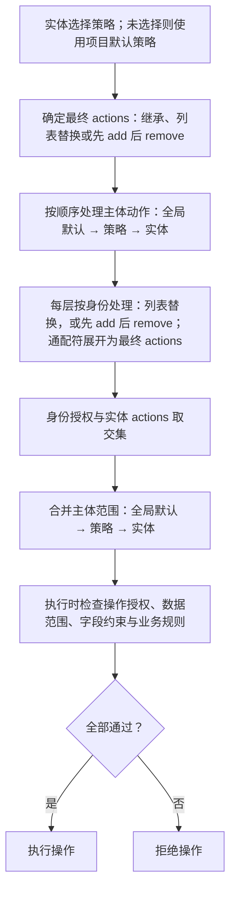

# 全局策略与实体定制

> 状态：首期已实现（统一配置编译与 mini-commerce 场景闭环）
> 整理日期：2026-10-28。本文实体 access 片段位于实体文件的 crud 节点下；可用配置以[策略声明与缺省约定](策略声明与缺省约定.md)和代码为准。

## 设计原则

- 全局归纳共性，实体默认继承、按需选择策略或定制差异。
- 采用一套策略体系，不额外引入独立的 `behavior` 配置层。
- `actions` 定义实体开放的操作；`access.<身份>.actions` 定义身份授权；`access.<身份>.scope` 定义身份数据范围。
- 常规实体尽量零配置，特殊实体只写差异；默认策略由项目决定。
- 策略继承与 HTTP 发布独立；默认策略不自动发布实体接口，沿用现有 HTTP 发布开关，内部实体可通过 `http-exposed: false` 关闭通用 HTTP。
- 身份不建立大小继承关系；超级管理员的全量授权通过显式 `*` 表达。

## 三类默认策略

| 策略 | 默认通用操作 | 变更方式 |
| --- | --- | --- |
| `maintainable`（可维护） | `view, create, update, delete` | 通用 CRUD，业务规则可进一步限制 |
| `workflow`（流程） | `view` | 实体显式开放创建、取消、发货等操作 |
| `record`（记录） | `view` | 内部追加、计算、刷新或重建 |

流程与记录的默认操作相同，但业务含义不同。记录既包括不可变的流水、日志，也包括可重算的统计、快照；不开放通用写接口，不等于禁止内部维护。

三类策略均为默认模板，名称不产生额外强约束。实体可显式替换 `actions`，最终能力以解析结果为准；首期不增加按策略类别禁止某类动作的第二套规则。

## 标准动作与执行映射

框架预定义标准动作及缺省执行映射，实体通过 `actions` 开放、通过 `access.<身份>.actions` 授权，普通实体无需重复声明映射。

| 标准动作 | 缺省执行入口 |
| --- | --- |
| `view` | 列表查询、单条详情 |
| `stats` | 统计查询 |
| `export` | 导出 |
| `create` / `update` / `delete` | 单条新增 / 修改 / 删除 |
| `batch-create` / `batch-update` / `batch-delete` | 批量新增 / 修改 / 删除 |

- 标准动作彼此独立授权；`view` 不包含统计、导出，单条与批量操作互不隐含授权。三类策略的默认集合保持精简，额外动作按需开放。
- 复用 `operations` 定制通用操作映射：动作项省略沿用缺省，非空列表整体替换，空列表关闭该动作的通用操作入口、保留业务 Handler。订单创建即下单时，关闭 `create` 的通用新增映射并显式绑定下单 Handler。
- `cancel`、`ship` 等业务动作显式声明并绑定 Handler；每个请求唯一确定执行目标，不能因 Handler 缺失回退到通用 CRUD，也不自动生成批量业务动作。
- 统计、导出遵守数据范围及对应字段权限；批量写入逐项授权、校验并遵守业务规则，首期采用全部成功或全部回滚，不支持部分成功。
- 标准动作统一预定义，首期只接入已有执行能力；开放的动作须有已启用组件及可用执行入口，未知动作、缺失 Handler 或映射冲突启动失败，不为补齐动作清单扩建导出等子系统。

## 全局配置：application.yml

```yaml
ent:
  loom:
    crud:
      access:
        default-policy: record

        defaults:
          access:
            super-admin:
              actions: ["*"]
              scope: all
            merchant:
              scope: merchant
            customer:
              scope: customer
        policies:
          maintainable:
            actions: [view, create, update, delete]
            access:
              merchant:
                actions: [view, create, update, delete]
          workflow:
            actions: [view]
            access:
              merchant:
                actions: [view]
              customer:
                actions: [view]
          record:
            actions: [view]
            access:
              merchant:
                actions: [view]
```

上述默认策略适用于商家型项目；身份定义与归属关系声明省略。`merchant`、`customer` 范围须解析到实体归属关系，不能因缺少关系字段退化为全量授权。归属赋值与写入校验见下文。

## 实体配置：选择与定制

已发布的普通商家实体无需声明 `access`，使用全局默认策略。公开商品增加匿名查询并显式声明公共规则：

```yaml
access:
  public:
    actions: [view]
    rules:
      active: true
```

公共商品可通过实体 `crud.access.public.rules` 声明 `active: true`，只查询已启用商品；实体还须声明公共返回字段的 `INCLUDE` 白名单（此处省略字段配置）。授予公共访问时，实体必须显式声明公共范围或规则和返回字段白名单，缺失则启动失败；全公开字典可显式声明 `access.public.scope: all`，不提供全局公共全量范围缺省。规则中的标量默认 EQ、列表默认 IN，多字段默认 AND；复杂范围留给受控 Java 扩展。列表、详情统一应用范围和字段约束，公共入口不混入登录身份权限。

商品仅允许所属商家的用户查询时，使用以下独立示例，不叠加上面的匿名授权。先在全局 `ent.loom.crud.access.relations` 中增加范围关系：

```yaml
ent:
  loom:
    crud:
      access:
        relations:
          customer-merchant:
            # 商品所属商家的字段。
            field: merchantId
            # 当前可信用户身份快照中的所属商家属性。
            identity-field: merchantId
```

商品实体选择可维护策略，商家维护自己的商品，用户只读所属商家的商品：

```yaml
access:
  policy: maintainable
  customer:
    actions: [view]
    scope: customer-merchant
  public:
    actions: []
```

| 身份 | 最终操作 | 数据范围 |
| --- | --- | --- |
| 超级管理员 | `view, create, update, delete` | 全量 |
| 商家 | `view, create, update, delete` | 自己商家的商品 |
| 用户 | `view` | 用户所属商家的商品 |
| 匿名访问者 | 无 | 拒绝访问 |

用户查询约束为：`商品.merchantId = 当前可信用户身份.merchantId`。`access.customer.scope` 表示用户身份下的数据范围，不固定等价于按 `customerId` 过滤。此关系只声明查询范围，不向用户授予写权限，也不把用户提升为商家身份；字段可见性仍由字段权限约束。

本例以一个用户只归属一个商家为前提。用户身份的 `merchantId` 必须由服务端根据有效归属解析，不能直接采信请求参数；关系或身份属性无法解析时拒绝访问，不能退化为全量查询。若一个用户可以属于多个商家，应先校验所选商家的成员关系并固定可信商家上下文，或使用成员关系查询约束，不能直接套用单商家等值范围。

商家流水只选择记录策略：

```yaml
access:
  policy: record
```

订单选择流程策略，开放业务动作并补充身份授权：

```yaml
access:
  policy: workflow
  actions:
    add: [create, cancel, ship]
  customer:
    actions:
      add: [create, cancel]
  merchant:
    actions:
      add: [cancel, ship]
```

| 身份 | 最终操作 | 数据范围 |
| --- | --- | --- |
| 超级管理员 | `view, create, cancel, ship` | 全量 |
| 用户 | `view, create, cancel` | 本人关联订单 |
| 商家 | `view, cancel, ship` | 所属商家订单 |

创建即下单时可直接使用 `create`。取消、发货、完结、退款等采用独立业务动作，不通过通用 `update` 绕过业务流程。动作须已有声明和实现，YAML 只负责开放和授权。

## 数据范围与写入边界

- 已授权身份必须有可用范围；静态缺失或无法编译时启动失败，运行时身份属性或关系无法解析时拒绝访问，不默认全量。全量访问须显式声明 `all`。
- 更新、删除的范围须进入实际写入条件，不能只依赖写前查询；修改时保护归属字段，状态流转与并发约束仍由业务规则保证。
- 创建须校验待写入数据的归属符合授权范围；查询范围不自动等价于归属赋值规则。可直接归属当前身份的字段由服务端填入，业务推导字段从可信数据解析，不采信请求中的归属值。
- 例如下单时，`customerId` 可取当前可信用户身份，`merchantId` 应由商品等可信业务数据推导并校验，不能机械复制当前身份属性。
- 业务 Handler 复用统一授权入口，接收可信身份与授权范围，并将范围落实到目标读取及实际写入；Handler 负责状态流转等业务规则，不另建可绕过授权的执行链。

## 继承与授权调整

| 配置 | 解析规则 |
| --- | --- |
| `policy` | 未声明时使用 `default-policy`；只选择一个策略 |
| `actions` | 实体省略则继承策略；列表整体替换，`[]` 关闭全部；对象继承后先 add 再 remove，同层移除优先 |
| `access.<身份>.actions` | 全局默认 → 所选策略 → 实体，逐层按身份处理 |
| `access.<身份>.scope` | 全局默认 → 所选策略 → 实体，按身份覆盖；可在实体局部调整 |
| 未授权身份 | 默认拒绝；仅配置数据范围不产生操作授权 |

实体动作也支持继承差异；全局策略仍使用完整列表，不支持动作通配符。例如可维护商品只增加批量更新：

```yaml
crud:
  access:
    policy: maintainable
    actions:
      add: [batch-update]
      remove: [delete]
    merchant:
      actions:
        add: [batch-update]
```

- 添加已开放动作、移除尚未开放的已知动作均幂等；未知动作（包括 remove 中的未知码）、重复项、null 和 `*` 均拒绝启动。
- actions.add 只开放能力，不自动授予身份；主体 actions 中的 `*` 按最终动作集合展开，因此会包含新增动作。
- 先确定最终 actions，再裁剪继承授权并校验实体显式授权和执行入口；显式授权已移除动作仍启动失败。
- 增量对象（含空对象）跟随策略演进；完整列表固定能力边界，`[]` 关闭全部动作。需固定能力的特殊实体继续使用列表。
- 有效配置诊断保留最终动作与实体差异来源；增量配置额外展示继承策略的 actions 来源。

身份授权支持三种写法：

```yaml
access:
  customer:
    actions: [view, create]
  public:
    actions: []
  merchant:
    actions:
      add: [cancel]
      remove: [delete]
```

- 无论上层是否声明该身份，都可直接使用 `add/remove`；未声明按空集合处理。
- 添加已有授权不重复，移除不存在的授权不报错；同层 `remove` 优先。
- `*` 先展开为实体最终 `actions`，再执行集合增减；逐层处理，后层可显式重新授权。
- `add` 只增加身份授权，不能突破实体最终 `actions`。
- `super-admin: ["*"]` 包含实体所有开放动作，但仍须通过数据范围及业务规则校验。

### 当前身份与声明校验

- 首期沿用当前可信身份上下文，每次请求按当前身份成套检查授权、数据范围与字段权限；不合并多个身份，不拼接不同身份的操作权限和数据范围。公共分支独立处理，不混入登录身份权限。
- 实体收窄 `actions` 时，继承授权按最终动作集合裁剪，属于正常继承处理；实体显式声明的授权或 `add` 项超出最终动作集合时，启动失败，不能静默忽略。`remove` 仍保持幂等，移除已知但未获授权的动作不报错；未知动作码始终报错。
- 未知策略、身份、动作、关系引用、缺失执行入口及无法编译的已使用范围均启动失败。错误须标明实体、配置来源及路径、错误值、原因和修正建议，例如：`实体 order：access.merchant.actions.add 包含未知动作 shpi，请检查是否应为 ship`。

例如在上述订单实体中，禁止超级管理员发货，只需补充：

```yaml
access:
  # 其他订单配置沿用前例，此处仅展示新增差异。
  super-admin:
    actions:
      remove: [ship]
```

## 权限解析流程



最终允许执行：**操作已开放、身份已授权、数据范围符合、业务规则通过**。

## 首期落地与验收

- 最小闭环：配置合并编译 → 复用现有授权与执行链 → 启动校验；不新增并行授权模型，额外标准动作仅接入已有能力。
- 场景验收：普通商品验证默认继承与商家隔离；公共商品验证显式范围、字段白名单及列表/详情一致性；订单下单、取消验证 Handler 绑定、可信归属、范围写入与状态规则。同时验证内部实体不会因默认策略新增 HTTP 入口。
- 提供实体有效策略诊断，输出最终动作、各身份授权、范围、字段约束及配置来源；可通过调试输出或受控诊断入口实现，首期不建设管理界面。

首期实现边界：支持查询、单条 CRUD、批量更新与显式业务 Handler；stats/export/批量新增/批量删除尚未接入此授权链，显式开放即启动失败。有 crud 对象声明且未关闭的实体才发布 HTTP，无声明实体不自动发布。简单固定字段规则通过 YAML `access.rules` 编译；复杂查询由 Handler 通过授权查询入口消费可信归属和范围。服务端诊断使用 ConfiguredAccessPolicies.snapshot()。示例订单创建使用 action/create，同名 create 的通用新增映射关闭。

公共分支的 EXPAND 默认 NONE；显式开放仅支持 INCLUDE，并须逐个列出 `customer.id` 这样的关联字段，不能用 ALL、EXCLUDE 或只列关联名称开放整段数据。

业务 Handler 的 `relatedAccess()` 默认空列表；关联 DAO 须声明目标实体、允许操作与范围字段。下单只读 Customer.id、MerchantProduct.id，只向 OrderItem.orderId 范围新增明细；调用时必须绑定声明字段的非空等值或 IN 条件，无限制范围、未声明实体及其他操作均拒绝。根实体仍自动叠加本次授权范围。

业务动作审计绑定最终事务完成通知：加入外层事务时等待最终提交或回滚，只记录一次结果；审计写入异常单独记录日志，不将已提交的业务改为失败。自定义事务执行器须实现 executeObserved，否则明确拒绝业务动作。
