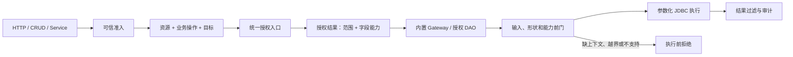

# 业务实体访问治理当前落地流程

> 状态：Current
> 最近整理：2026-10-12
> 本文只描述已存在的主链和明确的拒绝边界。目标语义见[策略声明与缺省约定](策略声明与缺省约定.md)和[概要设计](概要设计.md)。

## 1. 主链

准入只建立可信访问者和当前身份，不等于业务操作授权。授权结果绑定本次请求、资源、操作和目标，执行器不得从请求体、主键或普通属性重新推导权限。

根实体查询和授权 DAO 已消费 `BusinessAuthorizationService` 的按次结果；Stats、Import、Export 等存量 Gateway 当前仍以 `CrudGovernanceService` 和任务/文件守卫为主，属于 `LEGACY_ALLOWED`，尚未完成统一业务范围和字段能力收敛。

## 2. 当前可直接复用的内置能力

| 请求 | 内置入口 | 当前边界 |
| --- | --- | --- |
| 根实体 `LIST/PAGE` | `AuthorizedQueryExecutor` | 范围与调用方筛选取交集；列表和 count 使用同一条件 |
| 根实体详情 | 受授权查询执行器 | 从主键条件提取目标并重新授权；缺主键、多主键拒绝 |
| DAO 单目标读写 | `EntityDaoAuthorizationProvider.open` | 先按次授权，再创建绑定授权结果的 DAO |
| DAO 批量读取 | `authorizeBatch/openBatch`、`EntityDaoBatch` | 逐目标授权、逐目标字段能力、稳定顺序和逐目标审计 |
| DAO 批量 `UPDATE` | `openBatchWrite`、`EntityDaoBatchWrite` | 逐目标授权、版本校验、全量原子提交、commit 后成功审计 |
| 标准统计 | `StatsGateway` | 现有治理和 JDBC 执行链存在；统一业务范围/字段闭环仍待清理 |
| 标准导入导出 | `ImportGateway` / `ExportGateway` | 现有操作、任务和文件访问控制存在；统一业务范围/字段闭环仍待清理 |

普通实体优先选择这些内置能力，不为分页、筛选、字段白名单、授权 DAO、审计和幂等重复编写项目代码。

主 YAML 的 `ent.loom.crud.access` 已支持 `policies/entities/relations` 与按“实体 → 身份 → 用途 → mode/fields”登记的 `field-plans`，启动期编译为既有 Core 声明。全局关系按实体已有字段缺省推导归属，在元数据冻结前统一落实普通写入保护；ownership 显式列表整体覆盖，空列表关闭推导，底层显式范围约束仍保留。简单归属关系从可信身份读取。正式接入由项目提供认证与身份核验；简单身份统一由 `access.identities` 定义业务码、ID 字段和类型，Controller 用 `@EntAccess(identity = "customer")` 按码准入并接收统一 `AccessContext`；显式演示模式通过 `example.accounts` 核验静态归属，无需业务身份类或认证配置类；缺失关系、字段模式不完整、未知实体或身份引用及重复来源拒绝。完整语法与剩余目标见[策略声明与缺省约定](策略声明与缺省约定.md)。

## 3. 领域代码的边界

手写 Service/Handler 只负责内置能力无法表达的领域编排，例如跨实体事务、状态转换、外部副作用和复杂关系。它必须继续调用统一业务授权、受约束 DAO/Gateway 和审计能力，不得建立第二套权限判断或直接使用未授权 DAO。

以“下单”为例：客户和商品读取使用授权 DAO；订单、订单项、价格快照的一次性事务编排可以保留领域 Handler。以“商家分页订单”为例：直接使用内置 `AuthorizedQueryExecutor.page`，不再新增查询 Handler。

## 4. 当前拒绝边界

- 缺少可信访问者、按次授权结果或目标适用性，拒绝执行。
- 未映射的业务动作、未知字段、缺失关系和不匹配身份，启动期或调用期拒绝。
- 批量 `DELETE/INSERT`、归属变更、自动填充和没有事务能力的批量写入，执行前拒绝。
- 复杂关联、自定义 SQL 或其他存储没有落实范围和字段能力时，执行前拒绝。
- 直接 DAO 不能绕过业务操作授权；旧无作用域 DAO 不代表受治理资源可用。

## 5. 已有验证

当前基线使用 JDK 21，Core/JDBC/Starter 及依赖 Reactor 测试已通过。重点业务证据包括：

- `MerchantOrder` 用户端与商家端共用 PAGE 执行器，范围和额外筛选取交集，count 与数据条件一致。
- `MerchantProduct` 批量改价逐目标授权，版本冲突整批回滚，成功审计在 commit 后记录。
- DAO 单目标、批量读取和批量更新在授权结果、字段能力、目标校验和审计边界内执行。

完整命令、测试类和历史输出见[实施清单](实施清单.md)与[实施记录](实施记录.md)。
