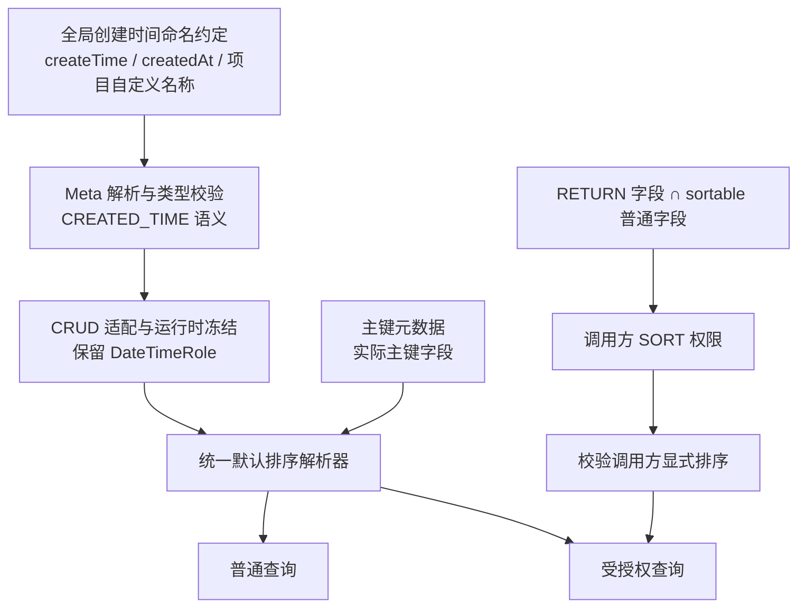
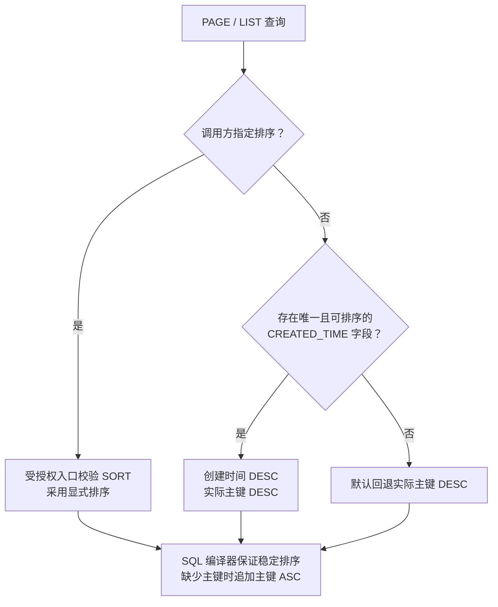

# 排序与创建时间约定重构要点

通过「全局命名约定 → 统一语义元数据 → 统一默认排序」，减少每个实体重复配置和逐字段注解。

## 设计链路



创建时间语义、服务器默认排序、调用方排序权限分别承担不同职责；默认排序不会额外授予字段权限。

## 主要改动

| 改动 | 结果 |
|---|---|
| SORT 缺省推导 | 省略 SORT 时，从 RETURN 中可排序的普通字段推导，减少重复白名单 |
| 全局创建时间约定 | 默认识别 `createTime`、`createdAt`，公共基类和实体无需逐字段添加日期角色注解 |
| 日期角色贯通 | `CREATED_TIME` 从 Meta 传递至 CRUD 冻结注册表，查询阶段直接消费语义 |
| 统一默认排序 | 普通查询和受授权查询共用 `QueryDefaultSortResolver` |
| 主键按元数据识别 | 使用实际主键字段，不要求属性名为 `id` |
| 删除重复配置 | 移除 `crud.query.default-sort.time-fields`，时间名称仅在 Meta 维护 |
| 示例简化 | mini-commerce 删除重复的 `[id, createdAt]` SORT 声明 |

## 不同项目的配置方式

默认名称符合项目习惯时，无需额外配置。使用 `recordedAt` 等其他名称时，全项目配置一次：

```yaml
ent:
  loom:
    meta:
      defaults:
        created-time-fields: [recordedAt]
```

- 显式列表整体替换默认名称；混用时配置 `[createTime, createdAt, recordedAt]`。
- 空列表关闭名称推导；名称不得为空、重复或带首尾空格。
- 仅匹配支持的日期类型：`LocalDate`、`LocalDateTime`、`Instant`、`java.util.Date`；同名文本、数值字段不参与推导。
- 显式元数据及项目 Java 约定沿用既有优先级。
- 约定提供创建时间角色、默认中文标签和普通写入保护，不负责自动填充时间值。

## 排序行为与权限边界



- 图中默认补全行为以默认配置为前提；开关、生效入口、方向、追加主键及回退仍可全局调整。
- 同一实体出现多个 `CREATED_TIME` 时启动失败；关系字段不能充当创建时间。
- SORT 显式 `INCLUDE / EXCLUDE / ALL / NONE` 覆盖缺省推导；`NONE` 关闭调用方排序权限。
- 隐藏字段和关系不会因缺省推导获得排序权限；动态权限继续收窄，交集为空不会重新开放。
- FILTER 同样支持从 RETURN 缺省推导；WRITE、STATS、EXPAND 仍需显式授权。
- 关闭业务默认排序补全，不会关闭 SQL 编译器的主键稳定排序兜底。

## 行为变化与验证状态

- 省略 SORT 后，允许调用方排序的字段可能比原 `[id, createdAt]` 白名单更多；需要严格白名单的实体继续显式声明。
- 默认列表顺序调整为创建时间、主键倒序，原先依赖升序的断言需要同步调整。
- JDK 21 完整 ent-loom Maven Reactor `install` 成功：1100 项无失败，含 4 项专用 MySQL 跳过；mini-commerce 90 项无失败，含 3 项专用 MySQL 跳过。
- HTTP/H2 回归覆盖创建时间优先于主键、相同时间按主键倒序稳定分页、显式排序覆盖默认值及既有权限隔离。
- 本轮未执行真实 MySQL 验证。

配置详情见 [配置参考](../../../../guides/配置参考.md)。
