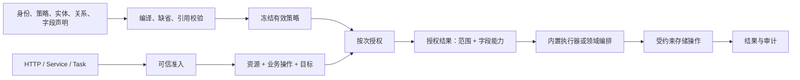
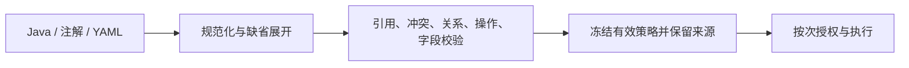

# 业务实体访问治理概要设计

> 状态：Target
> 最近整理：2026-10-07
> 本文定义目标职责和稳定语义，不声明所有能力已经实现。当前可用范围见[当前落地流程](当前落地流程.md)，差距见[实施清单](实施清单.md)。

## 1. 目标

让业务项目只声明身份、策略、关系和少量差异，普通实体请求由框架内置执行器完成授权、范围、字段、事务和审计。复杂业务可以扩展，但必须复用同一授权结果和执行边界。

本设计覆盖业务实体访问，不接管登录系统、岗位界面、支付状态机、通用工作流、生产调度和完整多存储事务。

## 2. 总体流程



授权结果不是客户端凭证，也不是可跨资源复用的权限票据。执行器必须验证授权结果仍对应本次访问者、资源、操作和目标。

## 3. 职责边界

| 层次 | 框架负责 | 项目负责 |
| --- | --- | --- |
| 准入 | 可信上下文、身份类型、来源限制和同步/异步边界 | 认证凭证、主体归属、真实身份解析 |
| 声明 | 策略编译、引用校验、冲突诊断、默认拒绝 | 身份、策略、关系、动态权限和实体差异 |
| 授权 | 操作判断、范围组合、字段能力、授权结果 | 业务关系事实、岗位权限、业务资格 |
| 执行 | Gateway、授权 DAO、标准 JDBC、能力门禁和审计 | 领域事务、状态规则、外部调用和特殊存储适配 |
| 文档 | Current/Target/Remaining 分层 | 项目接入说明和业务规则 |

Meta 可以提供实体字段、关系和静态约束；运行时主体和业务授权不进入 Meta Core。Core 合同保持框架无关，Boot、Web、JDBC 留在适配模块。

## 4. 内置优先

以下请求默认由内置能力完成：

- 单实体列表、分页、详情、筛选和排序。
- 单实体新增、修改、删除、版本校验和字段白名单。
- 已声明能力范围内的批量读取和批量更新。
- 标准统计、分组、筛选、排序。
- 标准导入、导出、任务状态和文件下载。

手写 Service/Handler 只负责内置能力无法表达的跨实体事务、状态转换、外部副作用、复杂关系或特殊结果。手写代码不得自行判断权限、直接使用无作用域 DAO、绕过字段能力或拼接不受治理 SQL。

## 5. 核心概念

| 概念 | 语义 |
| --- | --- |
| `AccessSubject` | 已认证的主体；区分人、服务、设备和匿名 |
| `BusinessIdentity` | 项目定义的当前业务身份及身份 ID |
| `VisitorContext` | 主体、当前身份、可信入口和调用链信息 |
| `BusinessOperation` | 稳定的资源 code 与操作 code；CRUD/scene 由适配层映射 |
| `EntityPolicyBinding` | 实体采用的策略、关系绑定和显式差异 |
| `AuthorizationRequest` | 本次访问者、资源操作和可选目标 |
| `AuthorizationResult` | 决策、范围、字段能力、原请求和审计关联 |
| `ExecutionContext` | 执行器消费的可信上下文和本次授权结果，不承载业务 payload |

授权请求和结果都按次创建。访问者、资源、操作或目标变化时必须重新授权。

## 6. 授权语义

```text
最终范围 = 策略范围 ∩ 动态业务范围 ∩ 必要关系约束 ∩ 调用方筛选
最终字段 = 策略字段 ∩ 实体静态上限 ∩ 操作用途限制
```

- 全量、无数据和受限范围是不同状态，不能用 `null` 或空 Map 暗示全量。
- 同一授权来源内的多个合法选择可以取并集；不同安全边界默认取交集。
- 配对关系必须保持元组结构，例如 `(商家A AND 店铺集合A) OR (商家B AND 店铺集合B)`。
- 关系事实提供事实，不自动授予操作权限；范围方案负责组合事实。
- 创建由服务端填充可信归属；更新、绑定和归属变更同时校验原目标和新目标。
- 解析失败、关系缺失、集合超限或执行器不能落实约束时拒绝。

字段能力至少区分 `RETURN`、`WRITE`、`FILTER`、`SORT`、`STATS`、`EXPAND`。调用方不能通过隐藏字段筛选、排序、聚合或导出推断未授权信息。

## 7. 声明来源与编译

Java、注解和未来 YAML 都是声明入口，但只能汇入同一个编译过程：



同一资源存在多个显式策略来源时报错，不按装配顺序覆盖。没有显式绑定时，只有纳入治理注册表且策略同名的资源才可推导绑定；无法确认资源或策略时拒绝。

## 8. 执行保证

- 查询、count、详情和写入必须实际消费授权范围。
- 写入必须落实 `WRITE` 字段、版本、影响行和业务状态约束。
- 批量写入必须声明原子性能力；不支持回滚的适配器默认拒绝。
- 成功审计只能在业务提交成功后记录；拒绝和执行失败分别保留原因。
- 异步任务不隐式继承线程身份；延后执行重新认证和授权。
- 不支持的操作在存储访问或业务副作用前拒绝，不能回退到旧的宽松路径。

## 9. 当前实现对照

| 目标能力 | 当前口径 |
| --- | --- |
| Java 策略、身份分支、实体绑定和显式差异 | 已有实现 |
| 按次授权、范围和字段结果 | 已有内核及部分执行适配 |
| 根实体查询、DAO 单目标、DAO 批量读取、批量 `UPDATE` | 已有 JDBC 闭环 |
| Stats、Import/Export 的统一业务范围和字段消费 | 现有 Gateway 存在，仍在清理范围 |
| YAML 严格解析、同名自动绑定、默认 `scope/fields` 展开 | Target |
| 子账号、代理、复杂关系和多存储 | 后续项目扩展，不能从基础节点能力推断已支持 |
