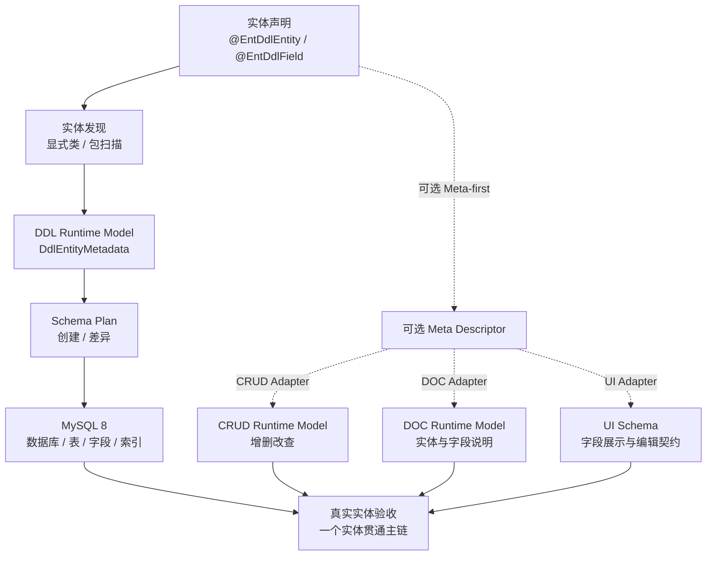
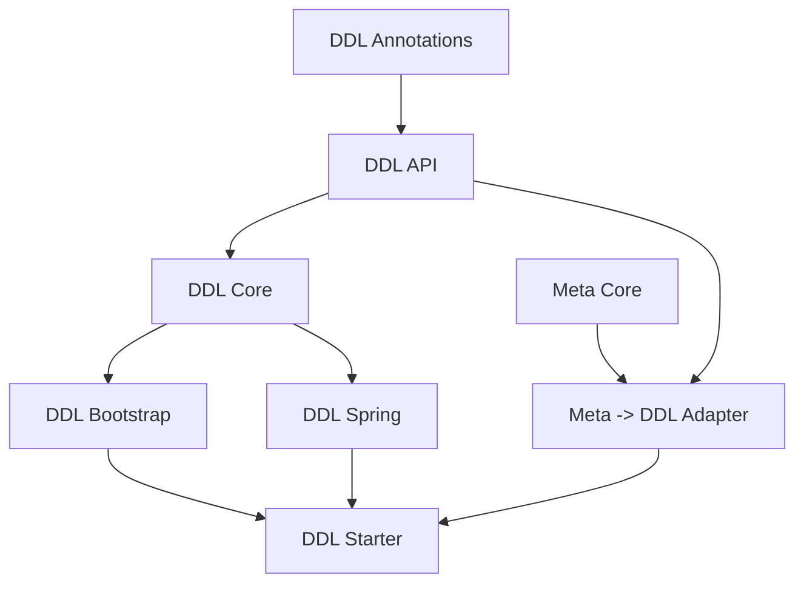

# DDL 实施清单

> 历史记录：2026-10-16 实体声明集中化迁移后，旧策略、动作、字段权限与索引注解及全局实体差异入口已删除。当前合同以[配置参考](../../../guides/配置参考.md#实体-yaml)为准。

> 状态：E5 与文本容量 P1–P3 已完成；业务语义缺省策略补齐已验收
> 当前大项：业务元数据到 DDL 文本推导补齐已收口
> 当前小项：无；正文与富文本缺省策略已收口
> 阻塞项：无
> 最近核验：2026-10-17，显式文本统一解析与 MySQL 8 闭环通过；全仓普通回归及定向真实数据库验收通过

本文是 DDL 的唯一执行看板。它把模块 README 中的能力设想收敛为可验收的阶段，后续每次只推进一个小项。

## 总目标

围绕实体编程框架形成以下纵向闭环：

完成定义不是“能生成一段 SQL”，而是：一个实体能够被发现、归一为 DDL Runtime Model、生成确定的 MySQL SQL，并在 Spring Boot 入口实际执行；随后可以与 CRUD、DOC、UI 的实体模型形成可验证的组合。

## 当前事实

| 项目 | 当前状态 | 说明 |
|---|---|---|
| DDL API / Annotations | 已具备基础类型 | 已有实体、字段、索引和执行请求契约 |
| DDL Core | E1 已完成 | 已建立稳定元数据合同、确定性 CREATE 编排和执行结果分类 |
| MySQL 建表 SQL | E1 已完成 | 已覆盖类型映射、主键、唯一约束、普通索引和表达式索引 |
| 实体解析 | E2.2 已完成 | Bootstrap 和 Spring 均已统一显式类、包扫描、去重和稳定排序；Starter 可绑定显式实体类名 |
| 实际数据库执行 | E2.5 已完成 | `ent-loom-ddl-spring` 已提供 Spring JDBC `QueryStrategy` / `SqlExecutor`，并有真实 MySQL 8 建库建表证据 |
| 消费者接入 | E2.4 已完成 | 独立消费者测试模块仅通过公开 Annotations、API 和 Bootstrap 构件完成最小实体接入 |
| 字段 / 索引差异 | E3 已完成并补充全量同步 | 已有表结构快照、稳定差异计划和受控 ADD / MODIFY SQL；显式 `CREATE_MODIFY_DELETE_ALL` 支持列删除、索引重建、主键及字段同步 |
| Meta -> DDL | 已完成 | `MetaDdlAdapter` 已提供 Meta-only、DDL-only 和 Meta + DDL override 投影 |
| DDL 测试基线 | 已建立 | Core 25 项、Spring 14 项和 Meta Adapter 7 项测试覆盖 SQL、差异、H2 读取 / 执行、投影、诊断和模块边界 |
| 实体全链路验收 | E5 已完成 | `CustomerProfile` 已覆盖静态 Runtime Model、MySQL 8 DDL、H2 + MockMvc CRUD 与使用说明 |

当前事实来源：`ent-loom-modules/ent-loom-ddl/README.md`、`ent-loom-integrations/README.md`、[实体全链路验收](../../../guides/ddl/实体全链路验收.md) 及现有实现；E1-E5 已完成，业务元数据到 DDL 补齐 P1、P2、P3 已完成，验收证据见下方。

## 范围与边界

### 当前纳入

- MySQL 8 数据库和表的创建。
- Java 类型到 MySQL 类型的确定性映射。
- 主键、字段、唯一约束、普通索引和表达式索引的建模。
- 显式实体类和 Spring 包扫描两种发现方式。
- SQL 生成、执行策略和执行结果的稳定合同。
- 新增字段、新增索引和有限字段修改的差异计划。
- Meta Descriptor 到 DDL Runtime Model 的适配。

### 当前不纳入

- 任意 SQL 执行平台。
- 复杂数据库迁移编排和跨版本回滚平台。
- 默认删除字段、删除索引和危险重命名。
- UI 菜单、权限、路由、组件渲染等业务语义。
- Java 8、Boot 2、Boot 4 兼容构件。

## 阶段总览

| 阶段 | 目标 | 主要模块 | 完成后结果 |
|---|---|---|---|
| E1 | 建立 DDL Core 的稳定建表合同 | `api`、`annotations`、`core` | 给定元数据可生成确定的 MySQL CREATE SQL |
| E2 | 接通实体发现和数据库执行 | `bootstrap`、`spring`、`starter` | Spring Boot 可按配置发现实体并执行建表 |
| E3 | 实现可控结构差异更新 | `api`、`core`、`spring` | 新增字段、索引和有限修改可生成 ALTER SQL |
| E4 | 接入通用 Meta 语义 | `ent-loom-meta-adapter-ddl` | Meta-first 实体可以投影到 DDL 模型 |
| E5 | 用真实实体验证整体能力 | 示例 / 集成测试 / 文档 | 一个实体贯通 DDL、CRUD、DOC、UI 验收路径 |

## E1（已完成）：Core 建表闭环

E1 只解决“给定 DDL Runtime Model，能稳定生成建表 SQL”的核心问题，不提前引入 Meta、UI 或复杂迁移策略。

### E1.1 稳定建表模型与 SQL 生成合同

- [x] 明确 `DdlEntityMetadata`、`DdlFieldMetadata`、`DdlIndexMetadata` 的必填字段和非法输入行为。
- [x] 明确单主键、复合主键、唯一字段、普通索引和表达式索引的 SQL 语义。
- [x] 明确 `DdlExecutionMode` 在 E1 中只开放 `NONE`、`CREATE_TABLE`、`CREATE_TABLE_AND_METAS` 的边界。
- [x] 保证同一元数据输入生成稳定、可比较的 SQL 顺序。
- [x] 为类型映射、默认值、注释、转义和标识符引用建立 Core 单测。

验收证据：`ent-loom-ddl-core` 测试通过，SQL snapshot 或等价字符串合同稳定。

### E1.2 建立 Core 执行编排

- [x] `DefaultDdlEngine` 对数据库、表、字段和索引生成结果进行明确分类。
- [x] `DdlExecutionResult` 能区分 generated、executed 和 errors。
- [x] `QueryStrategy`、`SqlExecutor` 保持 SPI 边界，Core 不引入 Spring JDBC。
- [x] `NoopQueryStrategy`、`NoopSqlExecutor` 仅作为显式测试 / dry-run 实现，不伪装成生产执行器。
- [x] 补充执行异常和空输入测试。

验收证据：Core 可在无 Spring 场景下完成生成模式和注入 fake executor 的执行模式测试。

### E1.3 E1 阶段门禁

- [x] `./mvnw -pl ent-loom-modules/ent-loom-ddl/ent-loom-ddl-core -am test` 通过。
- [x] DDL Core 无 Spring、Servlet、Starter 依赖。
- [x] 代码、测试和 README 对 E1 当前边界一致。
- [x] 更新本清单当前事实，并把 E2 设为当前阶段。

验收证据（2026-08-25）：

- 测试命令：`JAVA_HOME=/Users/zubin/Library/Java/JavaVirtualMachines/azul-21.0.10/Contents/Home ./mvnw -pl ent-loom-modules/ent-loom-ddl/ent-loom-ddl-core -am test`。
- 测试结果：Core Reactor 构建成功，`ent-loom-ddl-core` 共 17 项测试通过，0 失败、0 错误；扩展 DDL Reactor 共 22 项测试通过，0 失败、0 错误。
- 测试覆盖：Core 的 `MysqlCreateTableSqlBuilderTest`、`DdlMetadataContractTest`、`DefaultDdlEngineTest`、`DdlCoreBoundaryTest`，以及 Bootstrap/Spring/Starter 的主键推导和默认 SPI 测试。
- 边界验证：Core 运行时仅依赖 `ent-loom-ddl-api`，ArchUnit 验证不依赖 Spring、Servlet、Starter 或 Meta 包；测试依赖不进入运行时构件。
- 未完成工作（记录时）：E2 剩余的 Spring JDBC 执行器与真实数据库执行；E3 字段 / 索引差异；E4 Meta -> DDL Adapter；E5 实体全链路验收。

## 后续阶段清单

### E2：实体发现与实际执行

- [x] **E2.1 发现合同**：`DdlBootstrap` 统一显式类列表和包扫描入口；覆盖空输入、重复类、不可加载类、稳定排序和重复调用。

E2.1 验收证据（2026-08-25）：

- 测试命令：`JAVA_HOME=/Users/zubin/Library/Java/JavaVirtualMachines/azul-21.0.10/Contents/Home ./mvnw -pl ent-loom-modules/ent-loom-ddl/ent-loom-ddl-bootstrap -am test`。
- 测试结果：`ent-loom-ddl-bootstrap` 共 5 项测试通过，0 失败、0 错误；其上游 `ent-loom-ddl-core` 共 17 项测试通过，0 失败、0 错误；JDK 21 Enforcer 通过。
- 合同覆盖：显式类与包扫描合并、重复类去重、空输入、不可加载类跳过、按类名稳定排序，以及重复调用重新生成相同结果。
- 边界验证：Bootstrap 仅通过 `core`、`annotations` 和公开 DDL API 工作；Core 不依赖 Spring、Servlet、Starter 或 Meta Core；测试 fake 只实现公开 `DdlEngine` 接口。
- 未完成工作（记录时）：E2.2 Spring 配置与 Starter 装配；E2.3 Spring JDBC 执行器；E2.4 消费者测试；E2.5 MySQL 8 / Testcontainers；E3 字段 / 索引差异；E4 Meta -> DDL Adapter；E5 实体全链路验收。
- [x] **E2.2 Spring 装配合同**：为 `SpringAnnotationMetadataLoader`、实体 / 字段 / 索引解析和 `SpringPackageEntityClassResolver` 补齐测试；验证配置开关和缺少真实 SPI 时的诊断。

E2.2 验收证据（2026-08-25）：

- 测试命令：`JAVA_HOME=/Users/zubin/Library/Java/JavaVirtualMachines/azul-21.0.10/Contents/Home ./mvnw -pl ent-loom-modules/ent-loom-ddl/ent-loom-ddl-spring-boot-starter -am test`。
- 测试结果：`ent-loom-ddl-core` 共 17 项、`ent-loom-ddl-spring` 共 8 项、`ent-loom-ddl-spring-boot-starter` 共 4 项测试通过，0 失败、0 错误；JDK 21 Enforcer 通过。
- 合同覆盖：Spring 实体、字段、索引解析；空输入、重复包、不可扫描包、显式类与包扫描去重、稳定排序；`enabled=false` 不加载实体且不调用引擎；重复刷新只执行一次；缺少 QueryStrategy / SqlExecutor 时快速失败并保留中文诊断。
- 装配证据：Starter 标记 `@AutoConfiguration`，提供 Boot 3 `AutoConfiguration.imports`，保留 `spring.factories` 兼容入口；配置属性可绑定并装配 DDL 运行选项。
- 未完成工作（记录时）：E2.3 Spring JDBC 执行器；E2.4 消费者测试；E2.5 MySQL 8 / Testcontainers；E3 字段 / 索引差异；E4 Meta -> DDL Adapter；E5 实体全链路验收。本次未实现 JDBC、MySQL 或 Testcontainers。
- [x] **E2.3 执行器合同**：增加基于 Spring JDBC 的 `QueryStrategy` 和 `SqlExecutor` 实现，放在 `ent-loom-ddl-spring`；覆盖空输入、按输入顺序执行、执行异常、资源释放和结果保留。

E2.3 验收证据（2026-08-25）：

- 测试命令：`JAVA_HOME=/Users/zubin/Library/Java/JavaVirtualMachines/azul-21.0.10/Contents/Home ./mvnw -pl ent-loom-modules/ent-loom-ddl/ent-loom-ddl-bootstrap,ent-loom-modules/ent-loom-ddl/ent-loom-ddl-spring-boot-starter -am test`。
- 测试结果：`ent-loom-ddl-core` 共 17 项、`ent-loom-ddl-bootstrap` 共 5 项、`ent-loom-ddl-spring` 共 12 项、`ent-loom-ddl-spring-boot-starter` 共 5 项测试通过，0 失败、0 错误；JDK 21 Enforcer 通过。
- 合同覆盖：H2 验证表存在查询和逐条 DDL 执行；有依赖关系的两条 SQL 验证输入顺序；空输入不获取连接；Spring JDBC 数据访问异常向上保留；`JdbcTemplate` 管理连接释放；Core `DdlExecutionResult` 保留 generated / errors 并不伪造 executed 结果。
- 装配证据：存在 `DataSource` 且用户未提供 SPI 时，Starter 自动装配 `SpringJdbcQueryStrategy` 和 `SpringJdbcSqlExecutor`；用户自定义 SPI 仍由 `@ConditionalOnMissingBean` 保留；无 `DataSource` 时不装配默认 JDBC SPI。
- 边界验证：Spring JDBC 与 H2 仅进入 `ent-loom-ddl-spring` / Starter；Core 仍不依赖 Spring、Servlet、Starter 或 Meta Core；本次未引入 MySQL 驱动、Testcontainers、消费者测试或 E3/E4/E5 能力。
- 未完成工作（记录时）：E2.4 消费者测试；E2.5 MySQL 8 / Testcontainers；E3 字段 / 索引差异；E4 Meta -> DDL Adapter；E5 实体全链路验收。
- [x] **E2.4 消费者冒烟**：使用公开注解和 API 完成最小实体接入测试，不引用 Core 包内实现。

E2.4 验收证据（2026-08-25）：

- 测试命令：`JAVA_HOME=/Users/zubin/Library/Java/JavaVirtualMachines/azul-21.0.10/Contents/Home ./mvnw -pl ent-loom-tests/ent-loom-ddl-consumer-test -am test`。
- 测试结果：`ent-loom-ddl-core` 共 17 项、`ent-loom-ddl-bootstrap` 共 5 项、`ent-loom-ddl-consumer-test` 共 1 项测试通过，0 失败、0 错误；JDK 21 Enforcer 通过。
- 合同覆盖：独立消费者实体只使用 `@EntDdlEntity` / `@EntDdlField`；通过公开 `DdlBootstrap` 和 `DdlBootstrapRequest` 完成显式实体接入；公开 `QueryStrategy` / `SqlExecutor` fake 观察 generated / executed SQL 和最小建表字段。
- 边界验证：消费者测试没有导入 `com.entloom.ddl.core`、Spring、Servlet、Starter 或 Meta Core 包；测试构件仅声明 Annotations、API、Bootstrap 和 JUnit 依赖；本次未引入 MySQL 驱动或 Testcontainers。
- 未完成工作（记录时）：E2.5 MySQL 8 / Testcontainers；E3 字段 / 索引差异；E4 Meta -> DDL Adapter；E5 实体全链路验收。
- [x] **E2.5 MySQL 8 证据**：使用专用 profile 完成一次真实建库 / 建表验证，检查关键字段、主键和索引。

E2.5 验收证据（2026-08-25）：

- 测试命令：`JAVA_HOME=/Users/zubin/Library/Java/JavaVirtualMachines/azul-21.0.10/Contents/Home ./mvnw -Pmysql-integration -pl ent-loom-tests/ent-loom-ddl-mysql-integration-test -am test`。
- 测试配置：`ent-loom-test-support` 统一加载 MySQL 连接参数；优先使用 Maven `-Dentloom.mysql.integration.*`，其次使用 `ENTLOOM_TEST_MYSQL_*` 与根 `.env.local`。MySQL Connector/J 仅作为集成测试依赖；测试结束后临时 schema 已确认无残留。
- 测试结果：`ent-loom-ddl-core` 共 17 项、`ent-loom-ddl-spring` 共 12 项、`ent-loom-ddl-spring-boot-starter` 共 5 项、`ent-loom-ddl-mysql-integration-test` 共 1 项测试通过，0 失败、0 错误；JDK 21 Enforcer 通过。
- 合同覆盖：通过 Starter 自动配置按实体包扫描发现测试实体，并由 Spring JDBC 实际创建 schema 与表；验证 `id BIGINT`、`display_name VARCHAR(80)`、主键 `PRIMARY` 和 `idx_mysql_account_display_name` 普通索引。
- 边界验证：本次只验证 E2 建库建表执行，不实现 ALTER 差异、Meta Adapter 或 CRUD/DOC/UI 全链路；未引入 Testcontainers，E3、E4、E5 保持未开始。
- 未完成工作：E3 字段 / 索引差异；E4 Meta -> DDL Adapter；E5 实体全链路验收。

阶段门禁：Spring Boot 配置一个实体包即可在 MySQL 8 中完成建表；关闭 `enabled` 时不执行任何 DDL。E3 差异计划、E4 Meta Adapter 和 E5 跨 DDL / CRUD / DOC / UI 全链路不纳入 E2。

### E3：字段与索引差异

- [x] 抽象当前数据库表结构读取模型：公开 `DdlColumnMetadata`、`DdlTableSnapshot` 和 `QueryStrategy.readTable`。
- [x] 实现表注释、字段、主键、唯一约束和索引的差异计算，并统一数据库标识符大小写比较。
- [x] 实现新增字段和新增索引的确定性 `ALTER TABLE` SQL。
- [x] 实现有限字段修改和受控 `renameFrom`，明确删除、主键变化、索引重建和不兼容变化的拒绝原因。
- [x] 让 `CREATE_*` 与 `MODIFY_*` 执行模式有可测试的合法矩阵；受控模式拒绝危险差异，显式全量同步模式允许删除、重建及不兼容字段修改。
- [x] 建立执行前 SQL 预览和失败结果合同；发现危险差异时不执行部分计划。

E3 验收证据（2026-08-25）：

- Core 测试命令：`JAVA_HOME=/Users/zubin/Library/Java/JavaVirtualMachines/azul-21.0.10/Contents/Home ./mvnw -pl ent-loom-modules/ent-loom-ddl/ent-loom-ddl-core -am test`。
- Spring 测试命令：`JAVA_HOME=/Users/zubin/Library/Java/JavaVirtualMachines/azul-21.0.10/Contents/Home ./mvnw -pl ent-loom-modules/ent-loom-ddl/ent-loom-ddl-spring -am test`。
- 测试结果：Core 25 项、Spring 14 项测试通过，0 失败、0 错误；JDK 21 Enforcer 通过。
- Core 合同：`DdlSchemaDiffer` / `DdlSchemaDiff` 覆盖表注释、ADD 字段、ADD 普通 / 唯一索引、安全类型扩容、DECIMAL 整数位保护、字段重命名、自增属性保留、预览结果和危险差异拒绝；`DefaultDdlEngine` 逐条执行并保留已确认执行进度。
- Spring 合同：`SpringJdbcQueryStrategy` 通过 JDBC `DatabaseMetaData` 读取字段、主键、唯一索引、表注释和自增属性；MySQL 路径补充读取表达式索引；H2 实际执行新增字段并验证读取结果。
- 边界验证：Core 仍只依赖 DDL API，ArchUnit 继续验证不依赖 Spring、Servlet、Starter 或 Meta Core；测试 fake 只实现公开 API。
- 未完成工作：E4 Meta -> DDL Adapter；E5 DDL、CRUD、DOC、UI 实体全链路验收。

阶段门禁：从旧模型升级到新模型只执行声明允许的 ALTER，危险变更默认拒绝。

全量同步补充验收（2026-10-15）：

- `CREATE_MODIFY_DELETE_ALL` 按请求中的实体表同步结构，删除多余列和索引，允许字段收缩、显式重命名、主键替换和取消自增；单表差异合并为一条 ALTER，不删除未声明的其他表。
- JDK 21 执行 `./mvnw -pl :ent-loom-ddl-mysql-integration-test,:ent-loom-ddl-consumer-test -am -Pmysql-integration test`，Core 40 项、Bootstrap 8 项、Spring 19 项、Starter 5 项、独立消费者 1 项及真实 MySQL 8 验收 1 项全部通过。
- `DdlFullSynchronizationTest` 覆盖删除计划、生成与执行结果、主键和自增同步、无差异及生成失败时不执行部分计划；MySQL 验收使用随机隔离 schema，验证删除普通列和生成列、索引重建、删除后插入、保留未声明表、复合主键及连续重复同步。
- 模式与数据边界见[自动迁移安全边界](../../../guides/ddl/自动迁移安全边界.md)。

### E4：Meta -> DDL Adapter

- [x] 明确 Meta Descriptor 到 DDL 字段、实体和关系边界的映射表。
- [x] 实现 `ent-loom-meta-adapter-ddl` 的最小静态适配器。
- [x] DDL 专属属性不扩张通用 Meta；Runtime Model 已支持的属性进入 DDL 模型，暂未承接的显式属性通过结构化诊断暴露。
- [x] 覆盖 Meta-only、DDL-only、Meta + DDL override 三条路径。
- [x] 复用来源和诊断语义，冲突在 Adapter / Registry 边界暴露。

E4 映射边界：

| Meta Descriptor | DDL Runtime Model | 规则 |
|---|---|---|
| `entityName` | `tableName` | Meta-only 使用实体名；未提供时按 Java 类名推导 snake_case；DDL `@EntDdlEntity.table` 显式覆盖 |
| `description` | 实体 / 字段 `comment` | 仅作为通用说明投影；DDL 显式注释优先 |
| `fieldName`、`javaType` | `fieldName`、`javaType` | 保留 Java 字段身份和类型，物理列名按 snake_case 推导 |
| `EntFieldKind.ID` | `primaryKey` | ID 字段投影为主键；通用 `EntMetaId.AUTO` 不自动推导数据库生成策略，数据库自增必须由 DDL 原生属性显式声明 |
| 文本长度、数值精度 / 小数位约束 | `length`、`precision`、`scale` | 输入提示 `required` 不投影为 `nullable`；DDL 默认非空，可空例外由 DDL 显式声明；业务 `createDefaultValue` 不转成数据库 DEFAULT |
| `EntIndexDescriptor` | `DdlIndexMetadata` | Meta 字段名先转换为物理列名；唯一性和字段顺序保留 |
| `EntRelationDescriptor` | 无直接 DDL 结构 | E4 只要求 source field 可作为字段投影，不生成外键、联表或跨服务结构 |
| DDL `schema`、表规模、列定义、数据库默认值、重命名、生成策略、表达式索引 | DDL 专属属性 | Runtime Model 已支持的属性仅保留在 DDL 模型，不扩张通用 Meta Contract；暂未承接的显式属性发出 `CONSUMER_UNSUPPORTED_PROPERTY` 警告 |

覆盖规则：同一属性同时有 Meta 与 DDL 显式值时采用 DDL 值，并产生 `EXPLICIT_VALUE_CONFLICT` 诊断；Meta 推断值被 DDL 显式值覆盖时不构成冲突。

E4 验收证据（2026-08-25）：

- [x] 测试命令：`JAVA_HOME=/Users/zubin/Library/Java/JavaVirtualMachines/azul-21.0.10/Contents/Home ./mvnw -pl ent-loom-integrations/ent-loom-meta-adapter-ddl -am test`。
- [x] 测试结果：`ent-loom-meta-adapter-ddl` 7 项、上游 `ent-loom-meta-core` 21 项、`ent-loom-ddl-core` 25 项测试通过，0 失败、0 错误；JDK 21 Enforcer 通过。
- [x] 合同覆盖：Meta-only 的表名、主键、长度、精度、索引和不自动推导数据库生成策略；DDL-only 的 schema、注释、表规模、数据库默认值、重命名、显式生成策略和唯一索引；Meta + DDL override 的优先级及输入必填与可空性解耦；`AS_IS` 命名策略；未承接 DDL 属性的结构化警告；空输入、重复类去重和稳定排序。
- [x] 边界验证：适配器仅依赖 Meta Core、DDL Annotations / Core；实现和测试不引入 Spring、Servlet、Starter；测试只通过 `MetaDdlAdapter`、DDL API、Meta Annotations / Diagnostics 等公开 API 验证。
- [x] 阶段门禁：Meta-first 实体的通用字段、主键、索引和类型参数可投影为与等价 DDL-native 声明一致的 DDL Runtime Model；DDL 专属属性不进入通用 Meta。

未完成工作：E5 DDL、CRUD、DOC、UI 实体全链路验收。本次未实现 Spring 配置扩展、CRUD / DOC / UI 联动、HTTP 验证或新的数据库集成。

阶段门禁：同一实体使用 Meta-first 方式时，生成结果与等价 DDL-native 方式一致。

### E5：实体全链路验收

- [x] **E5.1 选择简单实体并完成静态模型组合验收**：使用 `CustomerProfile`，只包含主键、文本、数值、日期时间和图片地址字段，不声明复杂关系。
- [x] **E5.1 Meta / DDL / CRUD / DOC / UI Runtime Model**：通过公开构件完成内存模型投影；校验字段身份、snake_case 列名、类型参数、主键 / 索引、DOC 字段模型和 UI 的文本 / 数字 / 日期 / 图片组件。
- [x] **E5.1 可重复执行命令**：建立独立消费者测试模块 `ent-loom-tests/ent-loom-e5-static-test`，不进入生产依赖。
- [x] **E5.2 MySQL 8 与 CRUD HTTP 验证**：复用 `CustomerProfile`；通过 MySQL 8 DDL Starter 验证实际建库建表、字段、主键和唯一索引，并使用 H2 + MockMvc 覆盖 `create`、`detail`、`update`、`delete`。
- [x] **E5.3 Mermaid 与使用说明**：已在 [实体全链路验收](../../../guides/ddl/实体全链路验收.md) 记录实体投影主链、测试边界和 JDK 21 Maven Wrapper 命令；不扩展文档站和跨模块运行时接入。

E5.1 阶段门禁（已完成）：一个简单实体可以在内存中组合 Meta、DDL、CRUD、DOC、UI Runtime Model；不宣称已完成数据库执行或 HTTP 验收。

E5.1 验收证据（2026-08-25）：

- 测试命令：`JAVA_HOME=/Users/zubin/Library/Java/JavaVirtualMachines/azul-21.0.10/Contents/Home ./mvnw -pl ent-loom-tests/ent-loom-e5-static-test -am test`。
- 测试结果：`ent-loom-e5-static-test` 静态验收测试 1 项通过，0 失败、0 错误；上游 Reactor 构件测试通过；JDK 21 Enforcer 通过。
- 合同覆盖：同一 `CustomerProfile` 由 Meta Parser 生成 Descriptor，由 `MetaDdlAdapter` 生成 DDL Runtime Model 和确定性 MySQL CREATE SQL，由 `MetaCrudAdapter` 生成冻结 CRUD Runtime Model，由 `MetaDocAdapter` 生成 DOC Runtime Model 和边界输出；UI Runtime Model 在测试中仅使用公开 UI Contract，并从 Meta Descriptor 组装字段身份、展示名称和组件类型。
- 边界验证：测试仅使用公开构件和内存对象；不启动 Spring，不连接 MySQL，不发 HTTP，不使用 Testcontainers，不声明复杂关系或业务权限。

E5.2 阶段门禁（已完成）：同一简单实体可由 DDL Starter 在 MySQL 8 创建实际表结构，并可在不启动真实 HTTP 服务的 MockMvc 环境完成最小 CRUD 命令与详情查询。

E5.2 验收证据（2026-08-26）：

- 测试命令：`JAVA_HOME=/Users/zubin/Library/Java/JavaVirtualMachines/azul-21.0.10/Contents/Home ./mvnw -Pmysql-integration -pl ent-loom-tests/ent-loom-e5-static-test -am test`。
- 前置条件：MySQL 8 实例由根 `.env.local` 的 `ENTLOOM_TEST_MYSQL_*` 配置提供，测试账号需具备建库、建表和删库权限；Maven `-Dentloom.mysql.integration.*` 参数可临时覆盖。
- 测试环境：目标 MySQL 8 由测试专用配置提供；测试为每次执行生成随机 schema，并在 `finally` 中删除，无 Testcontainers。
- 测试结果：`ent-loom-e5-static-test` 共 3 项测试通过，0 失败、0 错误、0 跳过；上游 Reactor 构件测试通过；JDK 21 Enforcer 通过。
- DDL 合同：`E5MysqlDdlAcceptanceTest` 通过 `EntDdlAutoConfiguration` 的显式实体入口创建 `customer_profile`，验证 `BIGINT` 主键自增、`VARCHAR(64)`、`DECIMAL(10,2)`、`DATETIME`、`VARCHAR(255)` 与唯一索引 `uk_customer_profile_display_name`，并以公开 `QueryStrategy` 读取表快照。
- CRUD HTTP 合同：`E5CrudMvcAcceptanceTest` 使用 H2 与 MockMvc，不启动真实 HTTP 服务；依次验证 `create`、`detail`、`update`、`delete` 的成功响应、请求标识和实际 JDBC 影响行数。
- 边界验证：继续复用无关系的 `CustomerProfile`，只新增等价 `@EntDdlIndex` 以让 DDL Starter 读取唯一索引；不引入 Testcontainers、复杂关系、业务权限或生产依赖。

E5.3 阶段门禁（已完成）：使用者可从同一实体的声明理解 Meta、DDL、CRUD、DOC、UI 的验收投影，并可用 JDK 21 Maven Wrapper 复现静态、MockMvc 与 MySQL 8 测试。

E5.3 验收证据（2026-08-26）：

- 使用说明：[实体全链路验收](../../../guides/ddl/实体全链路验收.md) 明确 `CustomerProfile` 主链、索引物理列名边界、三项测试入口、MySQL 8 前置条件和两条 Maven Wrapper 命令。
- Mermaid：使用说明中的主链图区分静态 Runtime Model 投影、DDL Starter 到 MySQL 8、CRUD 到 H2 + MockMvc；不把它们表述为同一业务进程或同一数据源。
- 边界验证：不新增生产模块、Testcontainers、真实 HTTP 服务、复杂关系或业务权限。

E5 阶段门禁（已完成）：一个无关系的 `CustomerProfile` 已贯通静态 Meta / DDL / CRUD / DOC / UI Runtime Model、MySQL 8 DDL、H2 + MockMvc CRUD 和可重复的使用说明。后续业务元数据到 DDL 补齐按下方 P0-P3 执行项推进。

## 业务元数据到 DDL 推导补齐

规则依据：[业务元数据到 DDL 推导补齐方案](业务元数据到DDL推导补齐方案.md#p0-固定规则2026-10-17)。此处是唯一执行状态，方案仅维护合同与验收范围。

- [x] **P0 规则与范围**：2026-10-17 核对模型、三个加载入口、SQL 构建/比较及 JDBC 查询，固定显式文本支持清单、参数和容量算法、字符集读取路径、原始定义有限校验与计划阻断边界。仅文档与代码核对，未宣称运行时或 MySQL 验收完成。
- [x] **P1.1 模型与加载入口**：独立保存业务文本上限、物理长度、sqlType 及必要来源；Meta Adapter、Bootstrap、Spring 同步承接，Starter 默认 Spring Loader 纳入入口测试。该项不独立开放未经校验的类型生成行为。
- [x] **P1.2 字符集上下文读取**：DDL API 提供独立字符集模型、库/服务器查询接口与表/列快照；Spring JDBC 读取目标库/表/列及 MAXLEN，空 schema 只查当前 catalog，非 MySQL 不伪造上下文。重命名匹配、新增列/新表/新库的上下文选取与无连接构建参数传递由 P1.3 在引擎统一消费。
- [x] **P1.3 显式文本统一解析**：CREATE / Diff / ALTER 共用结果，检查参数、业务容量、声明冲突及已知索引冲突；MODIFY/CHANGE 保留原列字符集与排序规则；错误阻止整个执行计划。
- [x] **P1.4 阶段门禁**：JDK 21 Maven Wrapper 相关模块与上游测试；MySQL 8 验证三个入口及 Starter、utf8mb4 文本读写、允许修改/重命名后属性保留、再次比较无差异；未支持组合明确拒绝。通过后方可标记 P1 完成。
- [x] **P2 AUTO 文本容量推导**：复用同一解析合同，完成容量选型及对应验收。
- [x] **P2.1 显式 MEDIUMTEXT**：枚举与三个入口承接；统一解析、容量校验、规范化比较及 ALTER 复用；覆盖 utf8mb4 / latin1 上限与超限、参数及索引冲突、缺失上下文、受控迁移拒绝；真实 MySQL 验证三个入口建表与多字节读写、全量同步属性保留及再次无差异。
- [x] **P2.2 AUTO 文本容量选择**：按业务上限与有效字符集选择最小可用类型，保留无声明默认值及受控迁移白名单。
- [x] **P3 组合验收与示例**：完成组合回归与文档；MerchantArticle 仅在正文格式、真实业务上限与推导验收明确后调整，不虚构长度。

P1 验收证据（2026-10-17）：

- JDK 21 执行 `./mvnw clean test` 完成全仓普通 Reactor 回归：1136 项测试，0 失败、0 错误、5 项专用验收按 profile 默认跳过。定向执行 `./mvnw -pl :ent-loom-ddl-mysql-integration-test -am -Pmysql-integration test`：22 个构件成功，143 项测试，0 失败、0 错误、0 跳过，其中 Core 54、Adapter 13、Bootstrap 10、Spring 22、Starter 6、真实 MySQL 2 项，其余为上游测试。
- `MysqlColumnType` / `MysqlTableResolution` 保存不可变目标结果；引擎先获取库/表/原列上下文，再解析并在 CREATE / Diff / ALTER 中复用，不重复推导。新库、新表固定读取到的默认字符集，已有列 MODIFY/CHANGE 保留原字符集与排序规则，新列采用表默认值。
- 开放 String + VARCHAR / CHAR / TEXT / LONGTEXT；可识别原始定义进行同一校验和规范化；参数冲突、容量不足、已知类型不兼容及 TEXT 普通/复合列索引、主键、唯一约束冲突阻止整个计划。其他显式 sqlType/Java 组合拒绝且不回退；支持的声明不再产生 Adapter 消费未支持警告。
- `MysqlExplicitTextContractTest` 覆盖最坏编码宽度、边界、未声明长度、冲突、非法参数、缺失上下文、未知原始定义有限告警与已知错误阻断、重命名属性保留、受控转换拒绝、全量同步仍校验容量、计划错误零执行；字符与枚举维持原 AUTO 类型并保留文本列属性。
- `DdlExplicitTextMysqlTest` 与 `DdlMysqlIntegrationTest` 覆盖三个 Loader 及 Starter 默认路径、Meta-only/混合声明、四种文本类型建表与多字节内容、原始 VARCHAR 定义规范化、已有库/新库、表与列默认值不同、MODIFY/CHANGE 与新增列、显式全量同步、重复执行零差异。单列合法但整行超限时由真实 MySQL 拒绝；静态容量错误阻止其他实体表被部分创建。
- E5 静态 SQL 验收显式提供设计目标字符集并检查物理 SQL；MySQL 测试继续使用随机隔离 schema 与原清理约定。框架运行时未引入 Meta 依赖，新增跨入口测试依赖仅在测试构件。

当前边界：显式 MEDIUMTEXT 与 AUTO 容量选型已完成；普通文本无业务上限且无物理配置仍为 varchar(200)，正文和富文本缺省 TEXT；显式物理配置优先并校验业务容量；原始定义中的字符集修饰仅接受与已验证上下文一致的值，不自动转换字符集；未知原始定义保留原文并有限校验，不追加可能改变原意的字符集修饰；已有文本列无法可靠保留属性时明确拒绝修改，不能绕过已知参数/字符容量错误及迁移白名单。TEXT 非 NULL 默认值需要表达式合同，当前明确拒绝。MerchantArticle 现改用 CONTENT 业务类型推导默认 TEXT，不虚构业务长度，也不据此宣称覆盖任意正文输入。注释来源、数值、枚举增强、JSON 等仍为后续独立小项。

## 依赖与禁止跨越

- E1 不依赖 Meta、Spring 或 Starter。
- E2 才把实体扫描和真实数据库执行接到 Spring 层。
- E3 不反向修改 CRUD 的 Runtime Model。
- E4 不把 DDL 方言属性倒灌到通用 Meta Contract。
- E5 才建立跨 DDL、CRUD、DOC、UI 的真实调用者验收。

## 每阶段固定收尾

1. 代码和测试通过，记录命令、测试类和必要的 MySQL 8 验证证据。
2. 将已完成事实回写到对应 Architecture；没有稳定消费者前不创建架构占位页。
3. 删除本清单中已完成阶段的详细过程，只保留验收结论和未完成事项。
4. 更新[当前实施总览](../当前实施总览.md)和[框架实施清单](../实施清单.md)。
5. 将下一个阶段设为当前阶段，保持 DDL 主线一次只推进一个阶段。

P2.1 验收证据（2026-10-17）：JDK 21 定向 MySQL Reactor 22 个构件成功，144 项测试通过（含 2 项真实 MySQL 验收），无失败、错误或跳过。

P2.2 实现与验收（2026-10-17）：

- 仅对无显式物理配置且有正业务上限的 String + AUTO 启用容量选型；必须提供有效字符集，以 long 计算最坏字节数，依次选择 VARCHAR / TEXT / MEDIUMTEXT / LONGTEXT，超限拒绝。其他 Java 类型和无声明默认值保持原合同。
- 复用统一解析结果及 TEXT 参数、默认值、索引校验，受控迁移白名单不扩大。测试覆盖 utf8mb4 两组切换边界、latin1 的 VARCHAR/TEXT/MEDIUMTEXT 边界、LONGTEXT 超限、缺失字符集与物理覆盖不足；真实 MySQL 覆盖业务注解 AUTO 建表、中文 emoji 读写、全量同步保留列字符集、重复无差异。
- JDK 21 Maven Wrapper 全仓 `test`：1138 项，0 失败、0 错误、5 项专用验收按默认 profile 跳过；定向 MySQL Reactor：22 个构件成功、145 项测试通过（含 2 项真实 MySQL），无失败、错误、跳过。

P3 组合验收与示例核对（2026-10-17）：

- 增加真实 MySQL 组合：库默认 utf8mb4、表默认 latin1、原列 utf8mb4；新表 AUTO 使用库默认，新增列使用表默认，原列重命名与跨类别全量同步使用原列属性。验证 VARCHAR / TEXT / MEDIUMTEXT 选型、原数据保留、边界文本写入、受控拒绝零执行与重复无差异。
- E5 MySQL 测试通过 Meta Adapter 按业务资源码匹配 YAML，按 Starter 配置属性声明实体，统一声明校验与执行入口；注册共享 YAML 中实际 CRUD/DOC 声明消费者，保留组件校验，仅启动 DDL 执行链。
- 示例 Java 中仅 MerchantArticle 使用显式文本提示；正文格式和真实上限尚未明确，继续保留 TEXT，不虚构业务上限。示例 README 说明字节容量及业务输入校验边界；指南与架构事实同步更新。
- JDK 21 Maven Wrapper 执行 DDL MySQL + E5 及上游组合 Reactor：1071 项测试，0 失败、0 错误、0 跳过，包含 DDL 文本与 E5/DAO 真实 MySQL 验收；P2.2 全仓普通回归 1138 项的证据继续有效，本轮未改生产代码。

### 业务语义缺省策略补齐（2026-10-17）

此前 P1–P3 验证的是显式物理类型及长度驱动容量推导，未覆盖“业务类型缺省可用”的完整目标。本项补齐该缺口，不将文本容量闭环等同于全部业务语义推导完成。

- 新增 `EntFieldKind.CONTENT` 表达正文，避免将长篇纯文本误标为富文本。`RICH_CONTENT` 表达富文本格式类别；两者缺省提供 TEXT 存储提示，普通文本保持 varchar(200)。不根据字段名称或 multiline 猜测正文。
- 显式物理类型、length、columnDefinition 优先；无物理覆盖且有正业务上限时复用容量选型。富文本独立承接 richContent.maxLength，来源诊断同步；未声明上限不制造业务长度、不等同无限容量，TEXT 默认值/索引约束及迁移保护继续有效。
- MerchantArticle 移除 DDL 类型注解，仅用 `@EntField(value = "正文", kind = EntFieldKind.CONTENT)`；示例入口测试验证实际 MetadataLoader 输出正文 TEXT、标题 varchar(200)，二者不伪造业务上限。

- 验收：JDK 21 全仓普通 Reactor 1140 项，0 失败、0 错误、6 项按条件跳过；DDL 定向 MySQL Reactor 147 项全部通过。示例普通测试 92 项，0 失败、0 错误、4 项 MySQL 用例跳过；该 4 项随后在随机隔离 MySQL 库单独执行全部通过，包含 MerchantArticle 正文实际 TEXT 列及中文 emoji 读写，随机库已清理。
- 示例 H2 业务测试改用固定测试表结构并关闭 MySQL DDL，未伪造字符集；MySQL 结构验收显式启用 DDL。精细文本注解仅在长度、格式等定制需求下叠加，正文缺省仅需 EntField.kind，普通文本无需额外声明。
