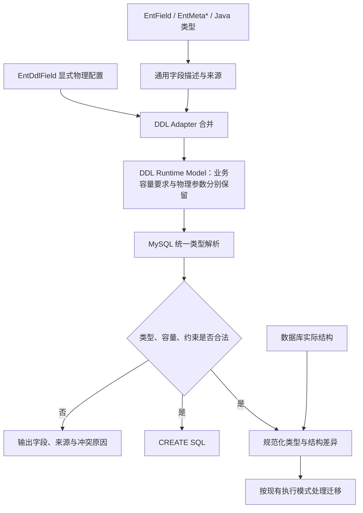
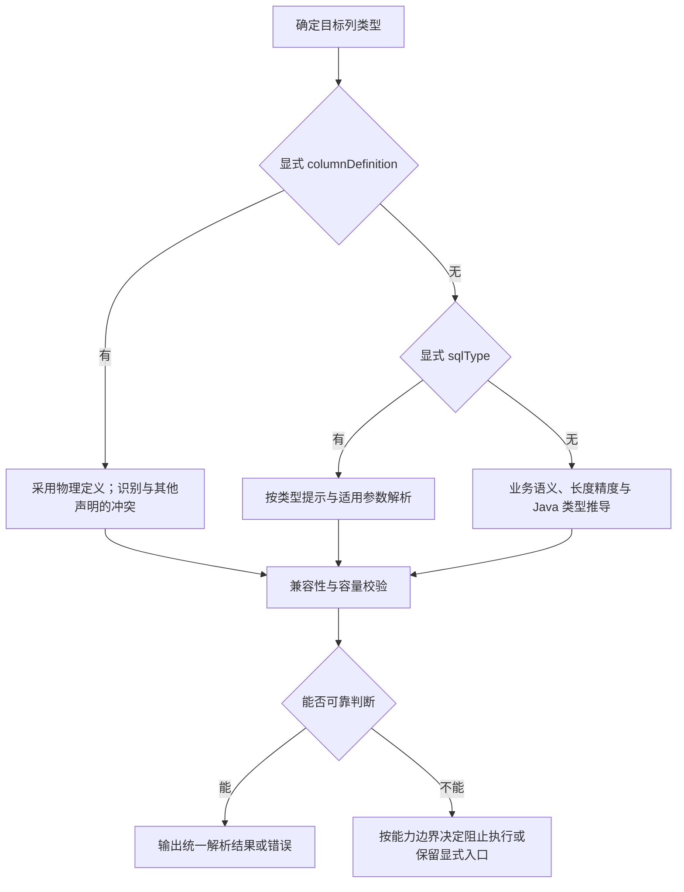

# 业务元数据到 DDL 推导补齐方案

> 状态：P0 / P1 已完成；显式文本与字符集上下文闭环已验收，P2 自动容量推导待实施。
> 梳理日期：2026-10-17。
> 本文记录建议规则与待办细节；执行状态统一回写 [DDL 实施清单](DDL实施清单.md)。

## 1. 目标与边界

让普通业务实体通过 `EntField`、`EntMeta*` 和 Java 类型提供可靠的存储默认值，特殊物理需求通过 `EntDdlField` 显式覆盖。

- 全部梳理 DDL 属性，逐项确定能否推导；不追求所有属性自动推导。
- `EntField` 保持通用语义；长度、精度等继续复用 `EntMeta*`。
- 不生成另一份 `EntDdlField` 注解，直接合并为 DDL Runtime Model。
- Meta 不依赖 DDL；方言规则留在 DDL 层，Adapter 只负责语义适配与来源合并。
- 本轮不另建迁移平台，不改变现有执行模式的安全边界。

首期闭环限定为：`String` 显式文本类型生效 → 保留业务容量要求 → 文本容量推导 → CREATE / Diff / ALTER 一致 → MySQL 8 验收。其他 Java 类型保持现有 `AUTO` 映射；注释来源调整、数值推导增强、枚举、JSON、日期时间、媒体和复杂对象转换另列后续小项。

## 2. 当前实现与缺口

以下为本次核对代码的结果，不代表所有相关消费者均已验收。

| 项目 | 当前实现 | 待补齐 |
| --- | --- | --- |
| 列名 | 字段名转换为 snake_case，支持 DDL 覆盖 | 复核所有入口一致性 |
| 持久化 | 合并 Meta、DDL 声明及 Java 单列类型判断 | 显式存储复杂对象时检查转换能力 |
| 主键、生成策略 | 已有主键语义与 ID 策略投影 | 保持现有合同，补充覆盖与冲突场景 |
| 长度、精度、小数位 | 已独立保留文本业务容量、显式物理长度及来源；数值仍保留合并参数 | 首期独立保留业务文本容量要求，校验物理覆盖；数值增强后续处理 |
| 字段注释 | Meta `description` 参与投影 | 首期沿用；后续评估采用 `label` 优先、`description` 回退 |
| SQL 类型 | 统一解析支持首期显式文本组合与原有 Java AUTO 映射 | P2 自动容量选择及后续业务语义增强 |
| 普通字符串 | 默认 `varchar(200)`，指定长度生成 `varchar(n)` | 超长文本不能仅拼接 VARCHAR |
| 显式 `sqlType` | String + VARCHAR / CHAR / TEXT / LONGTEXT 已生效，其他显式组合拒绝且不回退 | P2 补齐 MEDIUMTEXT；其他类型分项增强 |
| 其他物理属性 | `collation`、`dialectOptions`、`defaultValueHint` 同样存在不支持警告 | 逐项登记支持范围，不顺带承诺全部实现 |
| 枚举 | 基础映射为 `varchar(64)` | 核对真实持久化编码，不能只按名称假定 |

关键实现入口（相对仓库根目录）：

- `ent-loom-integrations/ent-loom-meta-adapter-ddl/.../DdlNativeAnnotationParser.java`：读取原生 DDL 注解。
- `ent-loom-integrations/ent-loom-meta-adapter-ddl/.../DdlRuntimeModelMerger.java`：Meta 与 DDL 合并、来源和冲突诊断。
- `ent-loom-modules/ent-loom-ddl/ent-loom-ddl-api/.../DdlFieldMetadata.java`：运行时字段模型。
- `ent-loom-modules/ent-loom-ddl/ent-loom-ddl-core/.../MysqlTypeMapper.java`：MySQL 类型映射。
- `ent-loom-modules/ent-loom-ddl/ent-loom-ddl-core/.../MysqlCreateTableSqlBuilder.java`、`DdlSchemaDiffer.java`：建表与差异比较。

## 3. 推导与校验流程

优先级针对同一属性生效：`columnDefinition` 完整物理类型定义 → 显式 DDL 类型与参数 → 业务元数据 → Java 类型及默认约定。列名、注释、可空性等独立属性各自合并。

该优先级用于确定物理目标，不会取消业务约束。业务 `maxLength` 与显式 DDL `length` 分别表达容量要求和物理参数，Runtime Model 必须分别保留，并携带必要来源用于诊断。例如业务 `maxLength=1000`、DDL `length=100` 时，不能合并成单个 100 后丢失业务要求；解析为 `varchar(100)` 应报告容量不足。物理容量大于业务上限时，业务校验仍按原约束执行。

首期只增加文本容量校验必需的模型字段，DDL Core 不依赖 Meta Descriptor，不建立通用约束平台。未声明业务上限时明确表示“未声明”，不把默认 `varchar(200)` 反写为业务约束，也不宣称覆盖所有业务输入。

覆盖不等于无条件合法。显式类型与 Java 读写能力不兼容、容量不足等问题仍须校验；不能通过提高优先级掩盖错误。CREATE、Diff、ALTER 从 P1 起共用统一目标类型解析结果；类型、参数与比较规范化不得在各入口独立推导。

诊断与执行边界：

| 情形 | 处理 |
| --- | --- |
| 参数非法、物理容量不足、已知类型不兼容或索引冲突 | 输出字段、声明来源、实际值与原因；作为错误阻止整个计划执行 |
| 非 `AUTO` 的 `sqlType` 或 Java 类型组合未在首期支持清单内 | 明确报错；不告警后回退为 Java 默认映射 |
| 自动容量推导依赖字符集，但无法确定有效字符集 | 阻止该自动推导及计划执行，提示明确字符集或使用显式物理定义 |
| 原始 `columnDefinition` 无法可靠理解 | 保留显式入口并输出有限校验告警；不标记为已通过容量或读写兼容校验，已知错误仍阻止执行 |
| 依赖数据库实际行布局、数据或约束才能判断 | 在明确静态校验范围后交由 MySQL 校验；不把执行成功等同于完成业务容量校验 |

`columnDefinition` 入口沿用现有注解所表达的物理类型及修饰定义，首期不扩展为包含 NULL、DEFAULT、COMMENT 等属性的完整列片段。可识别的定义参与统一解析与校验；无法识别时沿用现有差异比较与迁移安全边界，不扩大受控修改白名单。不为此引入完整 SQL 解析器。

### P0 固定规则（2026-10-17）

以下为已固定的实施合同；P1-P3 已完成文本闭环，实际范围及验收证据见唯一执行看板。

**容量与参数**

- Runtime Model 分别保存业务最大字符数（未声明为 `-1`）、显式物理长度和必要来源；来源只表达 DDL 需要的属性路径、声明类别，不引用 Meta Descriptor。
- `VARCHAR` 未提供物理长度时依次采用业务上限、默认 200；`CHAR` 未提供物理长度时依次采用业务上限、默认 1。显式长度必须大于 0；`CHAR` 不超过 255 字符。
- `TEXT / LONGTEXT` 不接受物理 `length`；业务上限仍单独校验。P2 的 `MEDIUMTEXT` 遵守相同规则。文本类型不接受显式 `precision / scale`，不能静默丢弃。
- 以 `long` 计算 `所需字节 = 业务最大字符数 × 有效字符集 MAXLEN`，不通过样本内容猜测压缩容量。未声明业务上限时只检查类型和参数，不宣称容量满足任意输入。
- P2 的 AUTO 选择：正业务上限 `n` 满足 `n × MAXLEN + 2 <= 65535` 且 `n <= 65535` 时选择 `VARCHAR(n)`；否则按所需字节选择最小的 `TEXT`（65535）、`MEDIUMTEXT`（16777215）、`LONGTEXT`（4294967295）。超出 LONGTEXT 容量报错。保守预留 VARCHAR 两字节长度开销，不估算整行布局。
- 显式 VARCHAR 同样检查上述单列字节上界；显式 CHAR 检查字符上界。业务上限不能大于 CHAR/VARCHAR 字符长度；TEXT 家族以字节容量校验。`maxLength=0` 不生成零长度 VARCHAR，报告非法容量声明。
- `utf8mb4` 的 AUTO 边界：16383 字符为 VARCHAR，16384 字符为 MEDIUMTEXT；4194303 字符为 MEDIUMTEXT，4194304 字符为 LONGTEXT。TEXT 在该最坏编码宽度下不会由这套 AUTO 策略选中，仍可显式声明。
- TEXT 家族参与主键、字段 unique 或可定位的普通/复合列索引时阻止计划；不改写索引。表达式索引不新增 SQL 解析器，不声称已完成表达式容量校验；其合法性由 MySQL 验收。VARCHAR 索引及多列行大小同样不承诺仅凭单列校验即可建表。

**有效字符集上下文**

| 场景 | 获取路径与处理 |
| --- | --- |
| 已有列修改或重命名 | MySQL `information_schema.COLUMNS` 读取 `CHARACTER_SET_NAME / COLLATION_NAME`；重命名按 `renameFrom` 定位原列；MODIFY/CHANGE 显式保留原列属性 |
| 已有表新增列 | `information_schema.TABLES.TABLE_COLLATION` 联结 `COLLATIONS.CHARACTER_SET_NAME` 得到目标表默认字符集；不使用库默认值覆盖已有表默认值 |
| 新表、已存在的库 | 当前无专用建表字符集配置；读取 `SCHEMATA.DEFAULT_CHARACTER_SET_NAME / DEFAULT_COLLATION_NAME`，生成建表 SQL 时固定该默认值，避免解析和执行使用不同默认值 |
| 请求自动创建的新库 | 读取 `@@character_set_server / @@collation_server`，生成 CREATE DATABASE 时固定默认值；继续向新表传递同一上下文，不先执行建库再发现容量错误 |
| 字符集最大编码宽度 | `information_schema.CHARACTER_SETS.MAXLEN`；只信任目标字符集对应的正整数，不使用连接字符集，也不把未知字符集猜成 utf8mb4 |
| 无数据库的直接 SQL 构建或 dry-run | 调用方显式传入上下文；需要字节容量判断而上下文缺失时明确失败。无需字节判断的原有 AUTO 默认映射保留 |

上述元数据查询使用参数绑定，并限定目标 schema/table；schema 未指定时先解析连接当前 catalog，不能跨库搜索同名表作为容量依据。字符集、排序规则标识符来自已验证的数据库元数据，原始定义的值也必须验证后再拼接。

`QueryStrategy` 承接必要读取能力，`SpringJdbcQueryStrategy` 实现 MySQL 查询，Core 只消费 DDL API 上下文。非 MySQL/H2 不伪造默认值，原有不需要字符集的测试路径仍可独立工作。表快照、列快照携带原属性；引擎由当前“先生成 CREATE 再 readTable”调整为“先读取必要上下文，再统一解析目标类型，再生成全部 SQL”。

**显式定义与诊断**

- P1 对 `String` 识别 `CHAR(n) / VARCHAR(n) / TEXT / LONGTEXT`（大小写、空白规范化）；`MEDIUMTEXT` 到 P2 开放。可识别字符集/排序规则修饰参与上下文检查，已有列显式要求转换时报错，不自动迁移字符集。
- 同时提供 `columnDefinition` 与显式 `sqlType / length` 时，等价声明可接受；不一致时报错，不能用定义优先掩盖矛盾。业务容量始终独立校验。
- 超出白名单的原始定义保留原文并发出有限校验告警；可独立确认的非法参数、未支持 sqlType/Java 组合和矛盾仍报错。不得把未知定义当作已通过容量或读写校验。
- P1 实现边界：原始定义的字符集/排序规则修饰仅接受与已验证有效上下文一致的值；其他配置不自动转换。TEXT 家族的非 NULL 默认值因尚无表达式默认值合同而明确拒绝，不静默生成 MySQL 无法接受的字符串默认值。
- 容量错误至少包含实体、字段、业务属性路径和值、物理声明来源和值、有效字符集及失败原因。错误进入现有执行结果，整个生成计划有错误时不得调用执行器；未知原始定义沿用现有差异安全边界。
- 首期不开放 `collation / dialectOptions / defaultValueHint` 的新注解行为，Adapter 继续明确不支持；保留数据库原排序规则不等于支持声明式排序规则转换。

**P0 代码核对基线与实施顺序**

- P0 核对时，`DdlNativeAnnotationParser` 只警告 sqlType；`DdlRuntimeModelMerger` 的单个 length 会覆盖业务上限；Bootstrap/Spring Loader 均未传递 sqlType。
- `MysqlCreateTableSqlBuilder` 与 `DdlSchemaDiffer` 分别处理 columnDefinition，必须改为消费同一个解析结果；ALTER 复用该结果并附加原字符集/排序规则。
- P0 核对时，`QueryStrategy` 仅有 tableExists/readTable；`DdlTableSnapshot`、`DdlColumnMetadata` 与 MySQL 列查询尚未保留字符集。建表模式同样需要按需获取上下文，不能只补修改模式。
- P1 按模型与加载入口 → 字符集读取 → 统一解析与 SQL → 入口及 MySQL 验收推进；中间步骤不标记 P1 完成。模型与读取合同先独立验收，不提前宣称显式类型已经生效；当前进度以实施看板为准。
- 原 700～1300 行估算不作为执行承诺；新增上下文读取、SQL 保留及入口测试后，P1/P2 按各小项实际 diff 记录，不按行数裁剪验收。

## 4. 属性映射建议

| DDL 属性 | 推导依据 | 建议规则 |
| --- | --- | --- |
| `column` | Java 字段名、命名策略 | 默认命名；显式 DDL 列名覆盖 |
| `comment` | 名称、说明 | 首期保持 `description` 投影及 DDL 显式覆盖；名称优先另行评估 |
| `persisted` | 通用持久化语义、Java 类型 | 复用现有判断；复杂类型检查编码与转换能力 |
| SQL 类型 | Java 类型、内容语义、容量 | 由方言统一解析；首期只新增支持清单内的文本组合 |
| `length` | 文本最大字符数、显式物理长度 | 业务容量要求与物理参数分别保留；不能把字符数当字节数 |
| `precision / scale` | 数值约束 | 首期沿用；后续增强范围、整数位和 Java 类型兼容校验 |
| `primaryKey` | 主键语义 | 复用现有主键识别，复核复合主键 |
| `generationStrategy` | ID 策略 | 复用现有映射；应用生成与数据库生成保持区分 |
| `unique`、索引 | 显式列约束、实体索引 | 复用现有合并；首期补充文本容量与索引冲突检查，保留复合索引顺序 |
| `nullable` | 独立物理约束 | 保持当前默认非空；可空例外显式声明；不从输入必填或包装类型推导 |
| `defaultValue` | 显式数据库默认值 | 不从 `createDefaultValue` 推导 |
| `renameFrom` | 显式迁移声明 | 不猜测历史列名 |
| `collation / dialectOptions` | 显式物理需求 | 保留 DDL 层；本轮先明确支持清单 |
| `defaultValueHint` | 显式默认值类型提示 | 与数据库默认值解析一起评估，不混用业务默认值 |

UI 的多行、只读、脱敏、展示名称及字段名 `content`，均不能单独成为选择 TEXT 的依据。关系语义不自动生成数据库外键。

## 5. 文本与其他类型的决策

### 文本：先确定容量，再选择物理类型

- `TEXT` 业务种类表示普通文本，不等同于 MySQL `TEXT` 类型。
- `RICH_CONTENT` 表示内容格式；单独配置它不保证获得足够的存储容量。
- `maxLength` 复用业务最大字符数；MySQL TEXT 容量按字节计算，需要明确有效字符集及最坏编码宽度。
- `maxLength = -1` 表示没有声明业务长度限制，不代表数据库容量无限，也不能直接据此将所有字符串改为 LONGTEXT。
- 首期无业务长度、无显式物理配置的 `String` 保持 `varchar(200)` 默认值；有业务上限时按容量策略选择类型，有显式物理配置时校验已声明的业务上限。
- 不能只按单列阈值宣称 VARCHAR 一定可建表：首期检查可确定的单列容量和索引冲突；依赖整行布局的限制交由 MySQL 验收，不实现完整行存储布局估算器。
- 长文本转为 TEXT 类后若与主键、唯一约束或普通索引冲突，明确报错；不自动删除索引、截短长度或改为前缀唯一索引。
- 暂不新增仅用于控制存储容量的 `LONG_TEXT` 业务类型。

实施前需在 P0 固定：新表与已有表的有效字符集来源及获取路径、按最坏编码宽度计算容量的方法、VARCHAR 选择边界，以及 TEXT / MEDIUMTEXT / LONGTEXT 的选择规则。不能用连接字符集代替目标列的有效字符集；当前结构读取与类型解析缺少所需上下文，需将必要读取能力纳入闭环。

修改已有文本列时，`MODIFY / CHANGE COLUMN` 必须保留原字符集与排序规则；新增列采用目标表的有效默认值，新表采用明确的建表配置或目标库默认值。引擎先取得必要结构与字符集上下文，再解析、校验目标列并生成 SQL；字符集与排序规则转换不纳入本轮自动迁移能力。

首期类型支持范围：

| 阶段 | 新增支持 | 边界 |
| --- | --- | --- |
| P1 | `String` + 显式 `VARCHAR / CHAR / TEXT / LONGTEXT`，以及可识别的同类 `columnDefinition` | 明确适用参数，检查业务容量要求；其他非 `AUTO` 类型组合报错 |
| P2 | `String` + `AUTO` 的容量推导，补充 `MEDIUMTEXT` 合同及显式支持 | 按有效字符集与业务上限选择类型，覆盖容量边界 |
| 后续 | 数值、枚举、JSON、日期时间等新增显式组合及推导增强 | 各自完成真实读写验收后再开放 |

`MEDIUMTEXT` 需要补齐 `SqlType`、Runtime Model 承接、类型解析、规范化比较和测试。所有阶段均保留其他 Java 类型已有的 `AUTO` 默认映射，不借文本补齐调整其存储合同。原始 `columnDefinition` 仍按第 3 节有限校验入口处理，不代表首期为其他类型新增读写支持。

`MerchantArticle` 的迁移原则：确认正文格式与实际业务长度上限，先保证推导结果正确，再删除冗余 `@EntDdlField`。若无法提供可靠容量约束，保留显式物理类型。不得虚构业务长度，也不得仅改成 `RICH_CONTENT` 就宣称问题已解决。

### 其他类型：逐项核对，分期实现

| 类型 | 核对重点 |
| --- | --- |
| 数值 | 精度、小数位、整数位和合法范围；不根据最小值自动推导 UNSIGNED |
| 枚举 | 与实际存储名称、业务编码或数字值保持一致 |
| 日期时间 | 区分日期、时间、日期时间，明确精度及 Instant 的时区转换合同 |
| JSON | 先确认读写序列化能力，再决定原生 JSON 列映射 |
| 媒体 | 依据实际 URL、资源 ID 或结构化对象表示，不能只看业务类别 |
| 复杂对象 | 默认不映射；显式存储要求具备确定的转换合同 |

## 6. 实施待办与验收

P0 规则、P1 显式文本闭环及 P2 MEDIUMTEXT / AUTO 容量选型已完成；P3 组合验收与示例边界核对已完成，验收证据见唯一执行看板。

| 阶段 | 待办细节 | 完成标准 |
| --- | --- | --- |
| P0 | 列出属性来源、默认值、优先级；固定首期文本组合、容量与诊断策略；确认字符集获取路径和各加载入口 | 支持、拒绝及有限校验范围明确，后续阶段可独立验收 |
| P1 | 承接支持清单内的 `sqlType`；分别保留业务容量要求与物理参数；补齐必要字符集上下文；统一 CREATE / Diff / ALTER 解析、校验与规范化比较；处理 `columnDefinition` 冲突 | Meta-only、DDL-only、混合声明可预测；覆盖不足与未支持组合报错；显式文本完成 MySQL 建表、允许的修改及再次比较无差异验收 |
| P2 | 实现文本容量选择与 `MEDIUMTEXT`；检查单列容量、已知索引冲突及适用参数 | 普通与长文本、默认值、边界值、容量不足都有明确结果；每项推导覆盖 CREATE / Diff / ALTER 并完成对应 MySQL 验收 |
| P3 | 汇总入口与迁移回归；完成组合场景的 MySQL 8 验收；更新文档和文章示例 | 前序阶段验证已通过，入口一致、重复执行稳定，示例与实现一致 |
| 后续 | 独立评估注释来源；逐项审计数值、枚举、JSON、日期时间、媒体和其他物理属性 | 注释行为变化单独验收；类型增强每项具备建表及真实读写的一致性证据 |

P1、P2 各自包含必要测试与真实 MySQL 验证，不能推迟到 P3 才首次验证类型一致性。

P1 同步补齐 Meta Adapter、Bootstrap `AnnotationMetadataLoader`、Spring `SpringAnnotationMetadataLoader` 的 `sqlType` 承接；Starter 默认 Spring Loader 路径必须纳入验收，入口一致性作为 P1 门禁。

必要验证：

- [x] Adapter：Meta-only、DDL-only、混合覆盖；独立保留业务容量与物理参数及必要来源；业务 `maxLength=1000`、DDL `length=100` 的容量错误可被识别。
- [x] Core：首期文本支持清单、其他 Java 类型原有 `AUTO` 默认映射、文本容量边界、非法参数与不兼容类型；未支持的非 `AUTO` 组合报错且不回退。
- [x] 一致性（P1 起）：CREATE、Diff、ALTER 使用同一目标类型结果，执行后再次读取比较无差异；P2 新增推导复用同一合同。
- [x] 入口（P1）：DDL-only 声明在 Meta Adapter、Bootstrap、Spring、Starter 默认路径中的类型与参数一致；Meta-only 及混合声明在支持 Meta 的入口中结果一致。
- [x] MySQL 8：新表及已有表的有效字符集读取、代表性多字节文本写入、索引限制、代表性多列行大小限制、重复执行稳定性。
- [x] 属性保留（P1）：已有列字符集、排序规则与表默认值不同时，修改或重命名后保留原属性，再次比较无差异。
- [x] 执行边界：容量不足及已知冲突阻止整个计划；自动推导缺少必要字符集时阻止执行；未知原始定义有有限校验告警，且不绕过已知错误或迁移安全边界。
- [x] 迁移：受控模式拒绝未获支持的跨类别转换；显式全量同步仍受数据库数据及约束校验。
- [x] 构建：JDK 21 + Maven Wrapper 运行相关模块及上游测试；运行时模型遵守所属构件的 Java 兼容目标。

## 7. 风险与改动估算

沿用 [自动迁移安全边界](../../../guides/ddl/自动迁移安全边界.md)，不因推导能力增加而扩大自动修改白名单。

| 风险 | 处理要求 |
| --- | --- |
| 原本被忽略的 `sqlType` 开始生效 | 检查仓库已有声明并评审结构差异，不视为无行为变化的修复 |
| VARCHAR 转为 TEXT 类 | 即使容量增大，也检查索引、默认值和锁表影响；受控模式不自动放行未支持转换 |
| 容量不足或缩容 | 尽早诊断；静态容量判断不能代替已有数据检查 |
| 物理参数覆盖后丢失业务容量要求 | 模型分别保留；按物理目标校验业务要求，不能只检查合并后的最终参数 |
| 字符集未知或上下文不一致 | 自动容量推导缺少必要上下文时拒绝执行；CREATE、Diff、ALTER 使用一致的有效字符集 |
| 目标与实际结构表达不同 | 统一规范化与比较，验证重复执行不产生伪差异 |
| 表能创建、数据不能读写 | 枚举、JSON 等必须核对运行时转换，未核对前不扩大推导 |
| 原始物理定义无法解析 | 清晰暴露校验范围，不增加通用 SQL 解析平台 |

粗估为代码、测试、文档的新增与修改量级，非精确 diff 统计：

| 范围 | 预计行数 |
| --- | ---: |
| 规则梳理与文档 | 80～150 |
| 显式文本类型、模型容量字段、统一解析与覆盖 | 200～400 |
| 文本推导、容量与冲突校验 | 200～400 |
| 必要测试与示例 | 200～350 |
| 优先闭环合计 | 约 700～1,300 |

当前文档本身不计入后续实现估算；模型调整、字符集读取、入口复用程度及真实 MySQL 验收范围会影响实际改动量。以上仅为首期初估，P0 完成后重新核算，不作为行数上限。其他类型与注释来源调整单独评估，避免一次改变过多默认行为。

## 业务语义缺省策略补充（2026-10-17）

前述 P1–P3 首先完成物理类型及业务长度驱动的容量闭环，不能据此宣称“仅业务语义即可推导”的目标已完整覆盖。补充规则如下：

| 业务声明 | 无物理覆盖时的缺省行为 |
| --- | --- |
| 普通 TEXT，未声明上限 | varchar(200) |
| `@EntField(value = "正文", kind = EntFieldKind.CONTENT)`，未声明上限 | TEXT；正文格式未限定，不强行标为富文本 |
| `@EntField(kind = EntFieldKind.RICH_CONTENT)`，未声明上限 | TEXT；富文本格式、清洗策略独立表达 |
| 以上文本声明正业务上限 | 使用有效字符集，复用 AUTO 容量选型；富文本采用 richContent.maxLength |
| 显式 DDL 类型、长度、原始定义 | 优先采用物理配置，仍独立检查业务容量及冲突 |

业务类型决定缺省策略，可选属性细化推导，物理注解仅为覆盖入口。多行展示和字段名称不触发长文本推导；缺省 TEXT 不保证无限容量，不替代输入校验，不扩大迁移白名单。MerchantArticle 移除物理 TEXT 注解，改用 CONTENT 类型作为实际验收样例。
