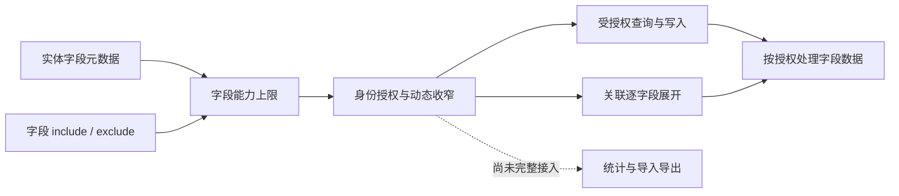

# 字段访问限制

`@EntCrudFieldAccess` 在字段上收窄实体的 CRUD 字段能力上限。未声明的字段继续使用实体元数据及现有配置推导的上限，身份授权仍可进一步收窄。

```java
@EntCrudFieldAccess(exclude = EntCrudFieldUse.ALL)
private String internalToken;

@EntCrudFieldAccess(exclude = {EntCrudFieldUse.FILTER, EntCrudFieldUse.SORT})
private BigDecimal cost;

@EntCrudFieldAccess(include = EntCrudFieldUse.RETURN)
private String displayName;
```

`include` 表示仅允许列出的用途，`exclude` 表示排除列出的用途，两者必须选择且只能选择一个。`ALL` 表示所有用途，不能与其他用途混用；用途列表不能为空或重复。`include` 不会突破字段本身的能力，例如不会让主键可写。字段限制不影响持久化、普通 Java 访问或内部归属范围校验。

关联展开同时遵守关联字段和目标实体字段的 `EXPAND` 限制。目标存在禁止展开的字段时，只能逐字段授权允许展开的字段，不能授权完整关联来绕过限制。现有 `@EntCrudEntity.fieldLimits` 仍然有效，不得超出字段注解收窄后的上限。

## 当前授权边界



- `RETURN` 和 `EXPAND` 是独立用途：排除 `RETURN` 不会自动禁止通过关联展开返回字段。需要禁止所有用途的敏感字段使用 `exclude = ALL`。
- 创建时，归属字段可由可信授权范围补齐；调用方提供归属值时必须与授权范围一致。普通更新不得修改归属字段，归属校验不代表开放普通 `WRITE` 权限。
- 当前创建成功结果会返回生成的主键，即使该字段没有 `RETURN` 权限；查询响应 schema 也尚未按本次授权过滤字段和筛选、排序能力。这两项为待修复的响应边界，不应依赖字段注解隐藏这些信息。
- 受统一业务授权治理的统计、导入导出执行形状尚未完整消费数据范围和字段能力，当前执行前拒绝；无统一授权治理的旧调用或直接调用底层引擎不受本注解保障。

响应边界的目标、验收项及统计和导入导出的暂缓范围见[业务实体访问治理实施清单](../../evolution/roadmap/crud/业务实体访问治理/实施清单.md)。
