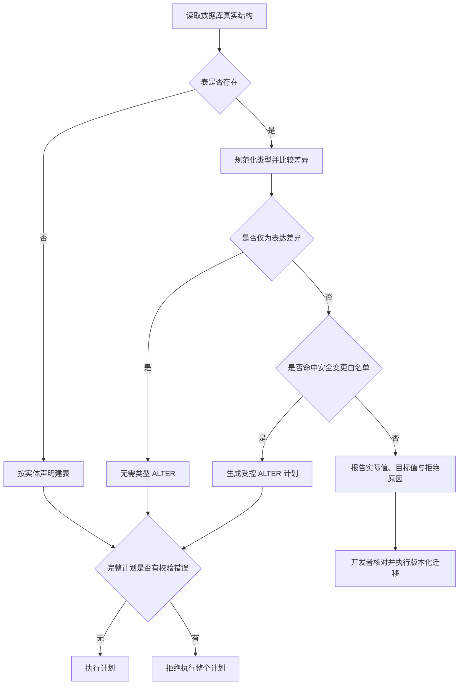

# DDL 自动迁移安全边界

原则：读取真实结构；默认修改模式只自动处理明确支持的无损变更，兼容的多余列保留并告警，不兼容差异报错。只有显式选择 `CREATE_MODIFY_DELETE_ALL` 时，才按实体执行包括删除在内的全量结构同步。

受控修改流程如下：



下表描述 `CREATE_MODIFY_TABLE_AND_METAS` 的受控修改边界。

| 类别 | 当前处理 |
| --- | --- |
| JDBC 将 `tinyint(1)` 报为 BIT | MySQL 从 `information_schema.columns.COLUMN_TYPE` 读取真实类型，不修改数据 |
| 类型大小写、整数显示宽度，如 `BIGINT(20)` 与 `bigint` | 规范化比较，不产生类型 ALTER；保留 unsigned 等属性差异 |
| VARCHAR / VARBINARY 长度增加 | 允许自动扩容 |
| DECIMAL 扩容 | 整数位、小数位都不减少时允许 |
| 已支持的数值扩容 | `tinyint → int/bigint`、`int → bigint`、`float → double`；不自动转换 signed/unsigned |
| 真实 `bit(1) → tinyint(1)`、缩短长度、降低精度、可空改非空 | 拒绝自动修改，使用版本化迁移 |
| 实体未声明的数据库列：可空、有默认值（包括空字符串）、自增或生成列 | 保留并告警，不生成 DROP，不阻止其他受支持迁移及应用启动 |
| 实体未声明的数据库列：非空、无默认值且非自增或生成列 | 实体插入不提供该列，阻止迁移及启动，提示显式处理列约束或清理旧列 |
| 删除或重建已有索引、改变主键、取消自增 | 拒绝自动迁移 |

现有能力还支持新增字段、索引、显式字段重命名及注释修改；这些操作仍须满足数据库约束，不能视为无条件安全。推荐新增可空字段，再由显式迁移回填与收紧约束。

多余列判断依据结构元数据，不扫描数据，也不推断触发器或实体只读用途；依赖触发器赋值等特殊场景使用显式迁移并关闭自动 DDL。列保留不代表额外唯一索引、外键等约束都与当前业务兼容。

`CREATE_TABLE` 只创建缺失表；`CREATE_MODIFY_TABLE_AND_METAS` 执行上述受控差异更新。自动修改适合本地开发，生产环境建议使用版本化迁移，应用可配置 `NONE` 关闭自动 DDL。

## 显式全量结构同步

`CREATE_MODIFY_DELETE_ALL` 适合开发环境跟随实体重构同步数据库结构：

- 创建缺失表，新增字段和索引，更新表与字段注释。
- 删除实体未声明的数据库列，包括非空且无默认值的旧列；删除数据库多余索引，重建定义变化的同名索引。
- 允许字段类型收缩或转换、可空改非空、显式字段重命名、主键替换和 `GenerationStrategy.NONE` 显式取消自增。未声明生成策略时保留现有自增属性。
- 只处理本次请求中实体对应的表；不会删除其他表、清空全库或先删表再重建。删除列会丢失该列数据，字段转换也可能丢失数据。

```yaml
ent:
  loom:
    ddl:
      mode: CREATE_MODIFY_DELETE_ALL
```

同一张表的差异合并为一条 `ALTER TABLE`，避免列删除引起索引隐式消失，以及主键、自增列分步修改的中间状态冲突。同步后再次读取真实结构，无差异时不生成 SQL。

全量同步仍受 MySQL 数据与约束校验限制：已有 NULL、重复值、无法转换的数据或外键依赖可能导致执行失败。框架不会关闭外键检查、放宽 SQL 模式或自动回填业务数据；失败后报告已执行语句数量并停止后续执行。

执行结果分别提供 warnings 和 errors；Spring 将告警以 WARN 输出，告警不影响成功状态。失败信息按编号展示执行模式、已执行 SQL 数量及每项差异。生成阶段发现任何错误，不执行整个计划；执行阶段失败保留已执行数量。MySQL DDL 不承诺事务回滚或零锁表，因此“数据无损”不等于“执行无风险”。

受控修改模式不做数据扫描推断或跨类别类型转换；全量同步模式允许提交类型转换，由 MySQL 校验和执行。两种模式均不提供自动备份回滚。验证覆盖真实 MySQL 布尔字段重复执行、整数显示宽度、安全扩容、受控模式拒绝危险变更，以及全量同步的列删除、索引重建、主键与自增修改和重复执行。
