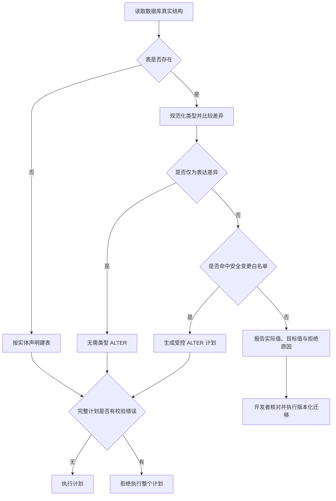

# DDL 自动迁移安全边界

原则：读取真实结构；明确支持的无损变更自动处理；无法证明安全的变更报错，由开发者执行版本化迁移。

| 类别 | 当前处理 |
| --- | --- |
| JDBC 将 `tinyint(1)` 报为 BIT | MySQL 从 `information_schema.columns.COLUMN_TYPE` 读取真实类型，不修改数据 |
| 类型大小写、整数显示宽度，如 `BIGINT(20)` 与 `bigint` | 规范化比较，不产生类型 ALTER；保留 unsigned 等属性差异 |
| VARCHAR / VARBINARY 长度增加 | 允许自动扩容 |
| DECIMAL 扩容 | 整数位、小数位都不减少时允许 |
| 已支持的数值扩容 | `tinyint → int/bigint`、`int → bigint`、`float → double`；不自动转换 signed/unsigned |
| 真实 `bit(1) → tinyint(1)`、缩短长度、降低精度、可空改非空 | 拒绝自动修改，使用版本化迁移 |
| 删除字段、删除或重建已有索引、改变主键、取消自增 | 拒绝自动迁移 |

现有能力还支持新增字段、索引、显式字段重命名及注释修改；这些操作仍须满足数据库约束，不能视为无条件安全。推荐新增可空字段，再由显式迁移回填与收紧约束。

`CREATE_TABLE` 只创建缺失表；`CREATE_MODIFY_TABLE_AND_METAS` 执行上述受控差异更新。自动修改适合本地开发，生产环境建议使用版本化迁移，应用可配置 `NONE` 关闭自动 DDL。

失败信息按编号展示执行模式、已执行 SQL 数量及每项差异。生成阶段发现任何错误，不执行整个计划；执行阶段失败保留已执行数量。MySQL DDL 不承诺事务回滚或零锁表，因此“数据无损”不等于“执行无风险”。

当前闭环不增加数据扫描推断、自动类型跨类别转换或自动备份回滚。验证覆盖真实 MySQL 布尔字段建表后重复执行、整数显示宽度、允许扩容与危险变更拒绝。
